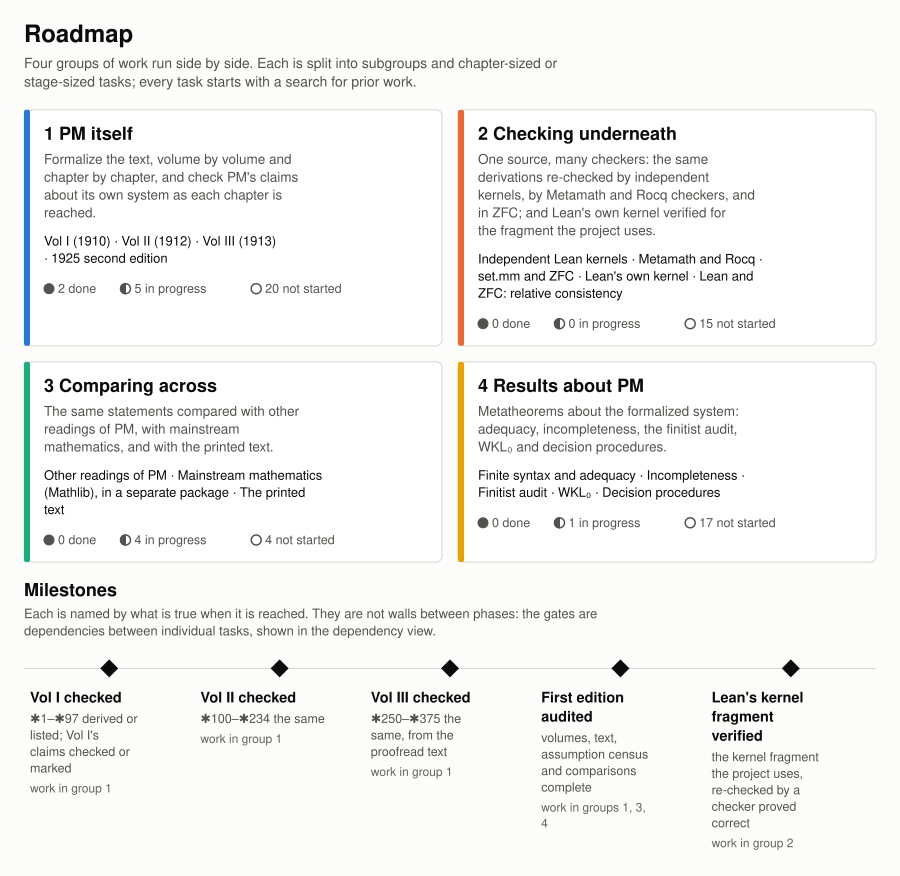
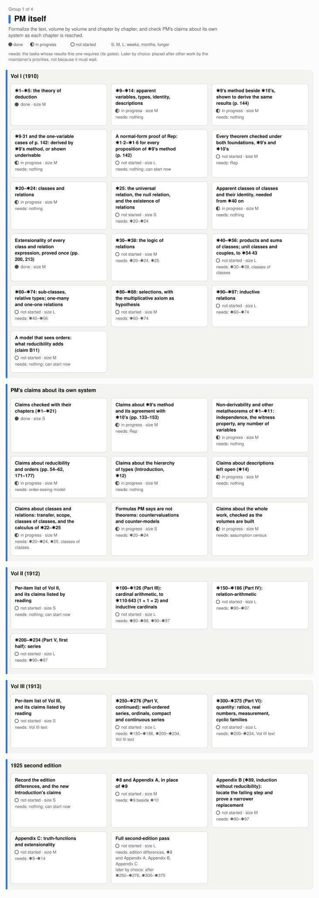
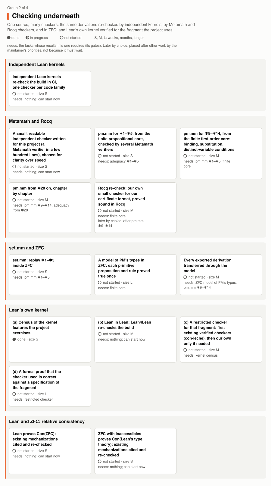
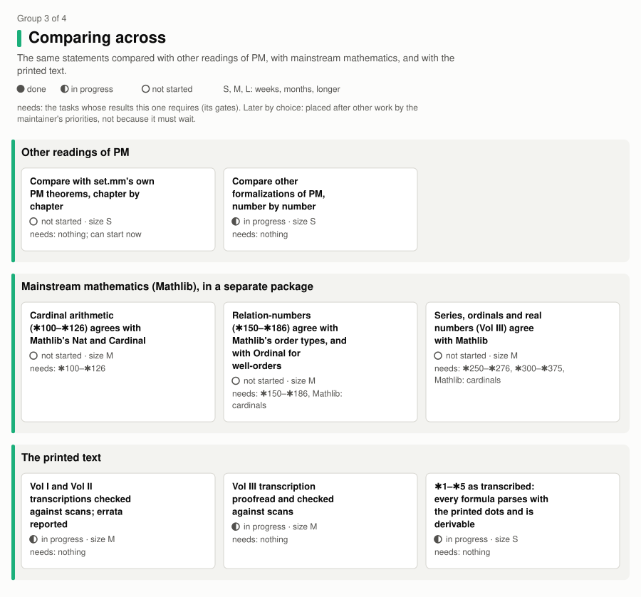
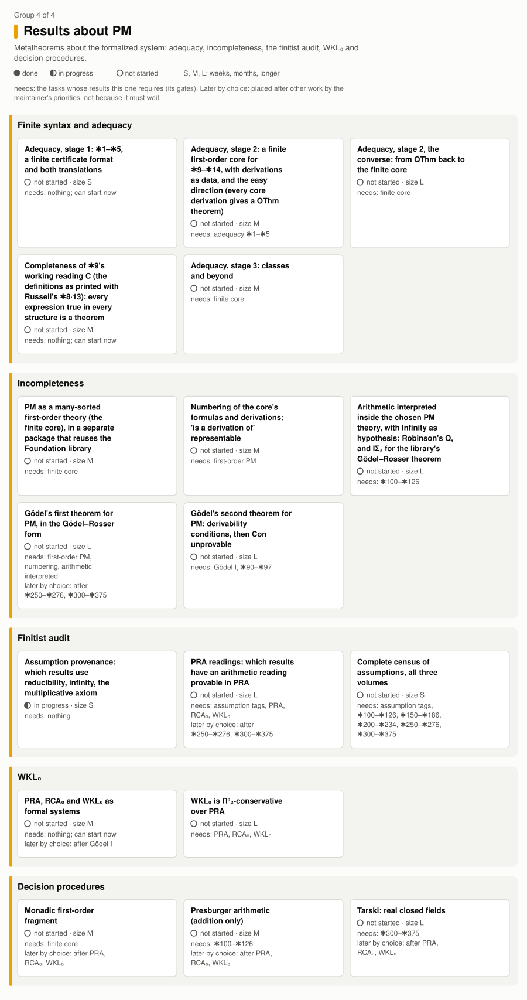
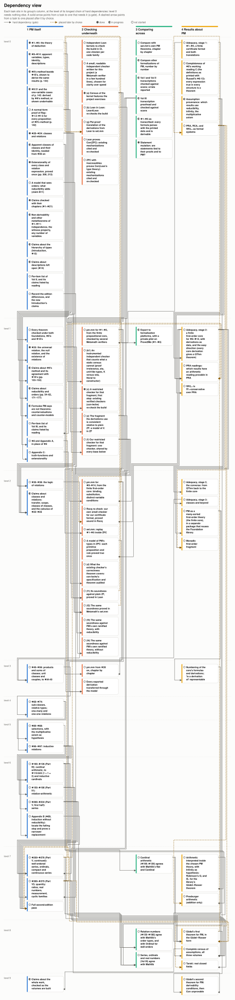

# Roadmap

What this project plans to do, how the pieces depend on each other, which tasks wait for others and why,
and what is already known about each from prior work. <!-- deps: none --> PM's claims about its own system, and their status,
are in [PM_CLAIMS.md](PM_CLAIMS.md); decisions already taken are in [TYPES_DESIGN.md](TYPES_DESIGN.md);
measured progress is in [PROGRESS.md](PROGRESS.md). This page was last revised on 2026-10-12, with the
statuses of the commit that contains it; the counts in it are read from PROGRESS.md, PM_CLAIMS.md and the
✱9 ledger (data/star9f_ledger.json) when it is generated, not copied by hand.



## Principles

**Search prior work first.** Before any task is started, and as the first step of every task, prior work
is searched in depth: existing formalizations (Lean, Rocq/Coq, Isabelle, HOL, Metamath, Mizar, Agda),
papers, theses, talks and repositories. Several independent search and deep-research tools are used and
their findings compared. An earlier search found a formalization of PM that had gone much further than
expected, so this is not a formality. The search saves work, gives ideas, shows early whether a task is
easy, hard or a dead end, and gives independent work to check ours against. Findings are recorded per
task: what exists, how far it got, its license, and whether its ideas can be reused. Code is never copied
from unlicensed repositories; ideas only. The searches are cheap and independent of each other, so all of
them can run now, ahead of the work they inform. The search is not a separate task: it opens every task.
What the searches so far found is listed under each subgroup below.

**Check PM's claims.** When PM asserts something about its own system (that two methods are equivalent,
that proofs carry over "by merely repeating previous proofs", that a construction "covers all the cases"),
the assertion is treated as a theorem to check in Lean, not an assumption to adopt. Each claim is listed in
[PM_CLAIMS.md](PM_CLAIMS.md) with its page and status, and is checked when its chapter is reached. A claim
found not to hold as stated is a result, recorded as such. Every row of PM_CLAIMS.md belongs to exactly one
task of this plan, most of them in the subgroup *PM's claims about its own system*, grouped by the page's
sections and by the kind of work they ask for; a task with claims is done exactly when each of its claims
is checked. Open: PM_CLAIMS.md covers only the pages read for it, the Introduction and ✱1–✱21, so the
claims PM makes in ✱22–✱97 (for example ✱25's "Proofs will not be given, as they proceed precisely as
in ✱24", p. 241) are not yet catalogued.

**One source, many checkers.** PM is formalized once, here, in Lean, and that development is the single
source. Other foundations do not get their own rewrite of PM: they receive the same derivations through an
automatic export and check them, as one carefully written program can be compiled by several independent
compilers. Work below the Lean development checks it; it does not replace it. Several checkers can all
accept a wrongly translated statement, so the translation itself is also checked (adequacy, below).

**The order is a plan, not a contract.** Work moves when it fits better elsewhere or costs little, and the
reason is recorded. Small tasks that are independent of the rest are done early. A task placed later than
its dependencies require says so (*by choice*, with the reason), and a task that has moved says where it
was and why ([Tasks that moved](#tasks-that-moved)). <!-- deps: none -->

## How the plan is organized

The work is in four **groups** that run side by side:

1. **PM itself**: the text, volume by volume and chapter by chapter, with PM's claims checked as each
   chapter is reached; and the 1925 second edition.
2. **Checking underneath**: the same derivations re-checked by independent Lean kernels, by Metamath and
   Rocq checkers, and in ZFC; and Lean's own kernel, verified for the fragment this project uses.
3. **Comparing across**: the same statements compared with other readings of PM, with mainstream
   mathematics (Mathlib), and with the printed text; and exported to formalization platforms, whose
   proofs come back to be checked here.
4. **Results about PM**: adequacy, incompleteness, the finitist audit, WKL₀ and decision procedures.

Each group is split into **subgroups**, and each subgroup into **tasks** the size of a chapter block or of
one stage of a larger piece of work. For each task the plan gives:

- its **status**: done, in progress or not started, read from the repository;
- its **size**: S (days to a few weeks), M (weeks to a few months) or L (several months or more), with the
  reason;
- what it **needs**: the tasks whose results it cannot do without. <!-- deps: none --> These are the **gates**: arrows between
  particular tasks, not walls between phases; <!-- deps: none -->
- what it is **helped by**: tasks that make it easier (shared tools, comparisons, experience) but are not
  required; <!-- deps: none -->
- its **order**: *by dependency* if it is placed as early as what it needs allows, or *by choice* if it is
  placed later than that, with the reason; <!-- deps: none -->
- the **prior work** found for it, with what the search found it good for (*reuse*: licensed code or data
  to import or depend on; *ideas*: read it, write our own; *check against*: an independent result to
  compare with; *nothing found*; *not yet searched*) and an evidence level for each entry: *measured* (its
  source was inspected at a pinned commit, and the entry links the repository, the commit and the file,
  with lines where useful; nothing was built unless said), *documented* (a paper or README says so; where
  the place has been recorded, it is cited), *unverified* (reported, not checked), or *from memory* (listed
  before the search reached this task). <!-- deps: none --> "Not found" means not found by the searches so far, not that nothing
  exists. Every repository inspected, with the commit read, is listed under
  [Where the prior work was read](#where-the-prior-work-was-read).

A few **milestones** mark the plan's progress, each named by what is true when it is reached:

<!-- generated:milestones:start -->
| Milestone | True when |
|---|---|
| Vol I checked | Every numbered assertion of ✱1–✱97 is derived from PM's primitive propositions, or listed with the reason it is not; every Vol I claim in PM_CLAIMS.md is checked or marked with why not. |
| Vol II checked | The same for ✱100–✱234: every assertion derived or listed with the reason; every Vol II claim checked or marked. |
| Vol III checked | The same for Vol III (✱250–✱375), read from its proofread transcription. |
| First edition audited | Vols I–III checked; the transcriptions of all three volumes checked against scans of the print; the census of which results use reducibility, infinity or the multiplicative axiom complete; the statement comparisons with set.mm and with other formalizations of PM complete. |
| Lean's kernel fragment verified | The kernel features this project exercises are listed; a checker with a machine-checked correctness theorem for that fragment (an existing one, or our own restricted checker) re-checks the PM derivations and, if it accepts the three standard axioms, the whole build; and what that theorem covers, and what it does not, is stated. |
<!-- generated:milestones:end -->

## The plan

The tables, lists and charts on this page and in the README are generated from one data file,
[data/roadmap.json](../data/roadmap.json), by [scripts/roadmap_chart.py](../scripts/roadmap_chart.py)
(see [Maintaining this page](#maintaining-this-page)).

<!-- generated:plan:start -->
### 1. PM itself

Formalize the text, volume by volume and chapter by chapter, and check PM's claims about its own system as each chapter is reached.



#### Vol I (1910)

| Task | Status | Size | Needs | Helped by | Order |
|---|---|---|---|---|---|
| ✱1–✱5: the theory of deduction | done. 188 of 188 assertions proved from ✱1·1–✱1·6; complete for two-valued truth tables (PM_CLAIMS A1: checked). | M: 188 assertions with ledgers and a completeness theorem; finished. | nothing | nothing | by dependency |
| ✱9–✱14: apparent variables, types, identity, descriptions | in progress. By ✱10's method: ✱10 46 of 48, ✱11 51 of 51, ✱13 25 of 25, ✱14 47 of 47, ✱9 4 of 28. ✱14·3 is proved as a schema; a type of propositions is revisited if Vols II–III or the 1925 pass need propositions as variables (TYPES_DESIGN.md, Q8). ✱9 by its own method is the next three tasks. | M: 199 assertions, 173 of 199 proved by ✱10's method; what is left is ✱9's own method. | nothing | ✱9 beside ✱10 | by dependency |
| ✱9's method beside ✱10's, shown to derive the same results (p. 144) | in progress. Built (PM/Found9, docs/STAR9_FOUNDATION.md), under four readings (docs/REPAIRS.md, docs/STAR9_READINGS.md): 28 of 28 numbered ✱9 propositions proved by ✱9's own method, along PM's lines, in the working reading C (the definitions as printed with Russell's ✱8·13 carried over to ✱9), and in Landini's ✱9+ (L) and the cross-check B; 27 under the definitions as printed (A), where ✱9·31 is open. `star9_iff_star10` makes the agreement conditional on Rep (✱1·2–✱1·6 for every ✱9 proposition) and on a variable of every type (PM_CLAIMS A29: partly checked). | M: A second set of primitive propositions, ✱9's development and an equivalence theorem. | nothing | nothing | by dependency |
| ✱9·31 and the one-variable cases of p. 142: derived by ✱9's method, or shown underivable | in progress. By the maintainer's ruling the working reading of ✱9 is C: the definitions as printed, with two quantifiers of the same kind the left side's first (the order ✱8 states and the Introduction defines: 1910 p. 49; second edition p. 47), and Russell's own rule ✱8·13 of the second edition (1925, Vol. I, Appendix A, p. 636) carried over to ✱9 as a primitive rule, each a marked repair (docs/REPAIRS.md, R1, R2). In C ✱9·31 is derived along PM's lines, ✱8·13 taking the step (3)–(4) (`f9_31_russell`). Landini's ✱9+ is kept as a checked variant, reading L, where his rule Switch takes the same step (`f9_31_switch`; R3), and our own convention as a cross-check, reading B (R4). Under the definitions as printed alone (reading A) ✱9·31 stays open, a question in its own right: line (4), cited as definitional, is not a definitional rewrite (`f9_31_step`), and no other step is cited. Of the 70 one-variable cases of p. 142 (PM_CLAIMS A10, A28: partly checked), 65 are proved in C, 63 in L, 50 under A and 67 under B (docs/STAR9_READINGS.md). Left: in C, 5 cases of ✱1·5–✱1·6 that the methods of ✱9·3–✱9·52 do not reach even with ✱8·13; in L, 7; under A, ✱9·31 and 20 cases; under B, 3 cases of ✱1·6 (docs/STAR9_FOUNDATION.md §5, §7): for each, a derivation in ✱9's method, or a proof that there is none. For C, first formalize ✱8·13 with a separating stroke that is not the principal one, as Russell allows (p. xxvi; R1; it needs, in ✱10, a normal form for formulas with one occurrence of a subformula); then whether C and L prove the same expressions, and whether either derives the prenex Switch (R5). Landini (2000) and ✱8 of the second edition are read (R1–R3; docs/STAR9_FOUNDATION.md §10). Still to read or check: whether Landini's paper restricts the formula A of Switch where our formalization must (`switch_wide_unsound`); Landini (1996), reported to give the same definitions and Switch; and the second edition's text against a 1925 printing, since the copy read is a 1963 impression, described as a photographic reprint. | M: The cases of ✱1·2–✱1·6 for one apparent variable per letter left in each reading (5 in the working reading, 20 and ✱9·31 under the definitions as printed); a proof of underivability would need a model of ✱9's method. | nothing | ✱9 beside ✱10 | by dependency |
| A normal-form proof of Rep: ✱1·2–✱1·6 for every proposition of ✱9's method (p. 142) | not started. With it, the agreement of the two methods (p. 144) rests only on a variable of every type. For the variables of a structure (`QModel.den`) an individual gives a value of every type (`den_nonempty`); for an arbitrary family of variables it does not, so there that assumption stays as stated. | L: A normal-form theorem for ✱9 derivations, in the style of Herbrand's work on quantification theory, or a completeness theorem for the reading (for the working reading C, the completeness task). | nothing | ✱9·31 and p. 142, C complete | by dependency |
| Every theorem checked under both foundations, ✱9's and ✱10's | not started | M: As StyleCheck does for the predicativity styles; done if the cost measured on a trial branch is reasonable. | Rep | ✱9 beside ✱10 | by dependency |
| ✱20–✱24: classes and relations | done. ✱20 53 of 55, ✱21 46 of 48, ✱22 72 of 72, ✱23 72 of 72 and ✱24 70 of 70 proved: done, the rest being ✱20·631·632 and ✱21·631·632, about significance, which are built into the syntax. ✱23's proofs follow the analogous ✱22 proofs, as PM directs (p. 226; PM_CLAIMS D16: checked). ✱24's statements follow the 1910 print where the transcription differs, and ✱24·51, which the transcription omits, is proved and counted (docs/FIDELITY.md). Claims of [PM_CLAIMS.md](PM_CLAIMS.md): D16. | M: 317 assertions, ✱24·51 included (the transcription omits it); ✱20–✱24 are done, ✱22 and ✱23 being the calculus of classes and of relations, ✱24 the universal class, the null-class and the existence of classes. | nothing | ✱9–✱14 | by dependency |
| ✱25: the universal relation, the null relation, and the existence of relations | done. ✱25 70 of 70 proved: all 70 numbered propositions and the three definitions (PM/Star25.lean). PM gives none of the proofs ("Proofs will not be given, as they proceed precisely as in ✱24", p. 241); each is written out along its ✱24 analogue's, and the ledger names the analogue per row (pm_text "analogue"); PM_CLAIMS D15: checked. The 1910 print's ✱25·37 and ✱25·412 are not theorems; the corrections the transcription applies, the analogues of ✱24·37 and ✱24·412, are proved (their source is not yet identified: docs/FIDELITY.md). Later chapters cite ✱25, from ✱31, ✱33, ✱34 and ✱35 on. Claims of [PM_CLAIMS.md](PM_CLAIMS.md): D15. | S: 3 definitions and 70 assertions (pp. 241–243), the analogues for relations of ✱24's, with the same numbering; PM prints no proofs, so each is written out along ✱24's. | ✱20–✱24 | nothing | by dependency |
| Apparent classes of classes and their identity, needed from ✱40 on | in progress. Decided (literal reading of ✱20·08) and built for the definitions and ✱20·4, ✱21·4; apparent classes of classes not yet (docs/CLASSES_OF_CLASSES.md). | M: A second layer of the class construction, built as printed (✱20·08), with its identity. | nothing | ✱20–✱24 | by dependency |
| Extensionality of every class and relation expression, proved once (pp. 200, 213) | done. PM_CLAIMS D1: checked, for the expressions PM's notation forms (`clsExpr_ext`, `relExpr_ext`). For a Lean function that uses the class otherwise, which PM's notation cannot form, the premise remains. Claims of [PM_CLAIMS.md](PM_CLAIMS.md): D1. | M: A general theorem over the expressions PM's notation forms, replacing an explicit premise. | nothing | ✱20–✱24 | by dependency |
| ✱30–✱38: the logic of relations | not started | M: Descriptive functions, converses, domains, relative products; mostly short proofs. | ✱20–✱24, ✱25 | nothing | by dependency |
| ✱40–✱56: products and sums of classes; unit classes and couples, to ✱54·43 | not started | L: Classes of classes throughout; ✱54·43 is the step before 1 + 1 = 2. | ✱30–✱38, classes of classes | nothing | by dependency |
| ✱60–✱74: sub-classes, relative types; one-many and one-one relations | not started | L: Typical ambiguity and relative types become central here. | ✱40–✱56 | nothing | by dependency |
| ✱80–✱88: selections, with the multiplicative axiom as hypothesis | not started | M: Selections and ✱88's multiplicative axiom, carried as an explicit hypothesis as PM states it. | ✱60–✱74 | nothing | by dependency |
| ✱90–✱97: inductive relations | not started | L: The ancestral and induction in ramified types; the base for Vol II and Appendix B. | ✱60–✱74 | ✱80–✱88 | by dependency |
| A model that sees orders: what reducibility adds (claim B11) | not started. The present models forget orders. Claims of [PM_CLAIMS.md](PM_CLAIMS.md): B11. | M: A new model in which the predicativity styles can differ without ✱12·1. | nothing | ✱9–✱14 | by dependency |

Prior work:

- **✱1–✱5** (check against). Done many times elsewhere; only this project and l-pommeret/Principia-Mathematica use PM's own ✱1 rules (docs/FORMALIZATION_COMPARISON.md). Metamath set.mm: 230 theorems labelled `pm1.`–`pm5.` and 280 with a PM number in all (labels matching `pm[0-9]+\.`, `$p` statements only, comments excluded, counted by scripts/count_setmm.py), CC0 (*measured*: [set.mm@405ce88 set.mm](https://github.com/metamath/set.mm/blob/405ce8897374f337393b19d25a128fdc52210fec/set.mm), [set.mm@405ce88 LICENSE](https://github.com/metamath/set.mm/blob/405ce8897374f337393b19d25a128fdc52210fec/LICENSE)); Metamath pmproofs.txt, ✱2–✱5 by condensed detachment, CC0 (*documented*); principia-rewrite (Coq, shallow: PM's propositions as Coq propositions over classical Coq, GPL-3.0): a comparison only (*measured*: [principia-rewrite@3f3bfc0 PL.v:1-4](https://github.com/LogicalAtomist/principia-rewrite/blob/3f3bfc09b43df42b34b03b2efb6ecdd764d1ea10/PL.v#L1-L4), [principia-rewrite@3f3bfc0 LICENSE](https://github.com/LogicalAtomist/principia-rewrite/blob/3f3bfc09b43df42b34b03b2efb6ecdd764d1ea10/LICENSE)).
- **✱9–✱14** (check against, ideas). l-pommeret/Principia-Mathematica (Lean 4): a deep ramified layer, ✱9 26 of 28 and ✱10 34 of 35 by our count (docs/FORMALIZATION_COMPARISON.md, built by us); no LICENSE file, so ideas only (*measured*: [Principia-Mathematica@3fb187a Principia/FirstEdition](https://github.com/l-pommeret/Principia-Mathematica/blob/3fb187a763db7865a46ec9204d33f1f318490a29/Principia/FirstEdition)); Metamath set.mm: 48 PM-numbered ✱10–✱14 theorems (✱10 13, ✱11 15, ✱13 11, ✱14 9), CC0 (*measured*: [set.mm@405ce88 set.mm](https://github.com/metamath/set.mm/blob/405ce8897374f337393b19d25a128fdc52210fec/set.mm)); Neo-Principia (Rocq, MIT): shallow, ✱9's definitions over Coq's `Prop → Prop` (*measured*: [Neo-Principia@752b04e pm/ch9.v:14-37](https://github.com/MudroadWhite/Neo-Principia/blob/752b04e18a9f1106b7088f6bdd05932a1876f8b5/pm/ch9.v#L14-L37)); Wang (1960): the predicate part of ✱10–✱14 is a decidable fragment (*documented*).
- **✱9 beside ✱10** (ideas, check against). Faithful ✱9 is reported hard. Landini (2000): §4 locates the flaw in ✱9·31's demonstration, which applies ✱9·03 to a p that contains quantifiers, and repairs ✱9 with two definitions (✱9·yy, ✱9·zz) and a rule, Switch; §5 proves the repaired system semantically complete for predicate logic without identity (*documented*: G. Landini, 'Quantification Theory in ✱9 of Principia Mathematica', History and Philosophy of Logic 21(1) (2000), 57–77, doi:10.1080/01445340050044646, §4 (pp. 63–64) and §5 (pp. 64–75); read in full); Urquhart (2016), on ✱9 and ✱10 (*documented*); Holmes's SML code (2002–04): a partial proof checker for ramified type theory, `theoldbook()` loading PM's ✱1 and ✱9/✱10 axioms, under a notice permitting free copying and use (*measured*: [Randall-Holmes.github.io@925857d RTT/rtt.sml:3](https://github.com/Randall-Holmes/Randall-Holmes.github.io/blob/925857da70ac7491cd5565574813fe0cccfc3599/RTT/rtt.sml#L3), [Randall-Holmes.github.io@925857d RTT/rtt.sml:4731](https://github.com/Randall-Holmes/Randall-Holmes.github.io/blob/925857da70ac7491cd5565574813fe0cccfc3599/RTT/rtt.sml#L4731)).
- **✱9·31 and p. 142** (ideas, check against). Landini (2000), §4: the flaw located in ✱9·31's demonstration (the moves from his lines 2 to 3 and 4 to 5 apply ✱9·03, stated for a quantifier-free p), and the repair: ✱9·yy, (x)Ax ∨ (y)By for (x)(y)(Ax ∨ By); ✱9·zz, (∃x)Ax ∨ (∃y)By for (∃x)(∃y)(Ax ∨ By); and Switch, from B[(x)(∃y)Axy] infer B[(∃y)(x)Axy] when a connective in A separates every free x from every free y. Formalized and kept as reading L, a checked variant (docs/REPAIRS.md, R3) (*documented*: G. Landini, 'Quantification Theory in ✱9 of Principia Mathematica', History and Philosophy of Logic 21(1) (2000), 57–77, doi:10.1080/01445340050044646, §4, pp. 63–64; read in full); PM's own Introduction defines the disjunction of two universal propositions: "(x).φx .∨. (y).ψy" as meaning "(x, y). φx ∨ ψy", which is Landini's ✱9·yy; ✱9 never states it (*documented*: Whitehead and Russell, Principia Mathematica Vol. I (1910), Introduction, Chapter II: 1910 p. 49 (Project Gutenberg eBook #78050, #Page_49; our transcription is from a scan of the 1910 edition); second edition p. 47, the page Landini cites); Russell's own rule in the second edition, ✱8·13: "If all occurrences of x are separated from all occurrences of y by a certain stroke, we can change the order of x and y in the prefix … and vice versa. Pp" (a primitive proposition, both directions, on the prefix). Carried over to ✱9 as the working reading C (docs/REPAIRS.md, R1) (*measured*: [Internet Archive item principia-mathematica_l2o7Ic0GMLeSLqcPnq, Principia_Mathematica_vol1.pdf, Appendix A, p. 636 (PDF page 680)](https://archive.org/details/principia-mathematica_l2o7Ic0GMLeSLqcPnq)).
- **Rep** (ideas). No search of its own yet; found while reading Landini (2000). Landini (2000), §5: completeness of ✱9 with his repair (reading L here), semantically, for predicate logic without identity, through a Russellian prenex normal form; adapting his proof is the first thing to try (*documented*: G. Landini, 'Quantification Theory in ✱9 of Principia Mathematica', History and Philosophy of Logic 21(1) (2000), 57–77, doi:10.1080/01445340050044646, §5, pp. 64–75; read in full).
- **both foundations** (not yet searched).
- **✱20–✱24** (ideas, check against). A shallow embedding is known to have stalled here. Neo-Principia (Rocq, MIT): ✱20 with 78 admitted steps; its own audit names the scope of incomplete symbols and host equality hiding reducibility as the blockers: a failure report to learn from (*measured*: [Neo-Principia@752b04e pm/ch20.v](https://github.com/MudroadWhite/Neo-Principia/blob/752b04e18a9f1106b7088f6bdd05932a1876f8b5/pm/ch20.v), [Neo-Principia@752b04e docs/5_audit.md:17-21](https://github.com/MudroadWhite/Neo-Principia/blob/752b04e18a9f1106b7088f6bdd05932a1876f8b5/docs/5_audit.md#L17-L21)); l-pommeret/Principia-Mathematica: 183 statements and 128 proofs over ✱20–✱56 (our count, docs/FORMALIZATION_COMPARISON.md) (*measured*: [Principia-Mathematica@3fb187a Principia/FirstEdition](https://github.com/l-pommeret/Principia-Mathematica/blob/3fb187a763db7865a46ec9204d33f1f318490a29/Principia/FirstEdition)); Holmes: polymorphic typing for PM's classes (*documented*).
- **✱25** (ideas, check against). Of ✱24's pointers, Neo-Principia stops at ✱20 and the l-pommeret count is for ✱20–✱56 as a whole, so ✱25's own file is cited here. l-pommeret/Principia-Mathematica: ✱25's three definitions, and theorems named for three of its assertions (✱25·104, ✱25·5, ✱25·58), with no sorry; its header records PM's remark that the unprinted proofs proceed as ✱24's (*measured*: [Principia-Mathematica@3fb187a Principia/Deduction/Star25Derived.lean:9-16](https://github.com/l-pommeret/Principia-Mathematica/blob/3fb187a763db7865a46ec9204d33f1f318490a29/Principia/Deduction/Star25Derived.lean#L9-L16), [Principia-Mathematica@3fb187a Principia/Deduction/Star25Derived.lean:244-392](https://github.com/l-pommeret/Principia-Mathematica/blob/3fb187a763db7865a46ec9204d33f1f318490a29/Principia/Deduction/Star25Derived.lean#L244-L392)).
- **classes of classes** (not yet searched).
- **extensionality** (not yet searched).
- **✱30–✱38** (ideas). Landini, 'Note on Principia's ✱38 on operations' (*documented*); l-pommeret/Principia-Mathematica: proofs into this range (*from memory*).
- **✱40–✱56** (check against). Metamath set.mm: pm54.43, with its own note on the translation (*measured*: [set.mm@405ce88 set.mm:110227-110244](https://github.com/metamath/set.mm/blob/405ce8897374f337393b19d25a128fdc52210fec/set.mm#L110227-L110244)); l-pommeret/Principia-Mathematica: proofs into ✱56 (our count, docs/FORMALIZATION_COMPARISON.md) (*measured*: [Principia-Mathematica@3fb187a Principia/FirstEdition](https://github.com/l-pommeret/Principia-Mathematica/blob/3fb187a763db7865a46ec9204d33f1f318490a29/Principia/FirstEdition)).
- **✱60–✱74** (ideas). l-pommeret/Principia-Mathematica: deep to about ✱70, then shallow (docs/FORMALIZATION_COMPARISON.md) (*measured*: [Principia-Mathematica@3fb187a Principia/FirstEdition](https://github.com/l-pommeret/Principia-Mathematica/blob/3fb187a763db7865a46ec9204d33f1f318490a29/Principia/FirstEdition)); PM-MATS citation graph: 9,944 numbered propositions and 35,380 citations; all rights reserved, so consulted for ordering only (*measured*: [PM-MATS@53c587c src/pmdata.json](https://github.com/LogicalAtomist/PM-MATS/blob/53c587ce95c5c66d2489f10b8b5b2dce10e522a4/src/pmdata.json), [PM-MATS@53c587c LICENSE](https://github.com/LogicalAtomist/PM-MATS/blob/53c587ce95c5c66d2489f10b8b5b2dce10e522a4/LICENSE)).
- **✱80–✱88** (ideas). PM-MATS citation graph: consulted for ordering only (*measured*: [PM-MATS@53c587c src/pmdata.json](https://github.com/LogicalAtomist/PM-MATS/blob/53c587ce95c5c66d2489f10b8b5b2dce10e522a4/src/pmdata.json), [PM-MATS@53c587c LICENSE](https://github.com/LogicalAtomist/PM-MATS/blob/53c587ce95c5c66d2489f10b8b5b2dce10e522a4/LICENSE)).
- **✱90–✱97** (ideas). PM-MATS citation graph: consulted for ordering only (*measured*: [PM-MATS@53c587c src/pmdata.json](https://github.com/LogicalAtomist/PM-MATS/blob/53c587ce95c5c66d2489f10b8b5b2dce10e522a4/src/pmdata.json), [PM-MATS@53c587c LICENSE](https://github.com/LogicalAtomist/PM-MATS/blob/53c587ce95c5c66d2489f10b8b5b2dce10e522a4/LICENSE)).
- **order-seeing model** (ideas). An extensional model proves consistency but cannot show that reducibility adds strength; that needs a model that sees orders. Reported research-level. Mares (2007): a semantics validating reducibility (*documented*); Fitch (1938), Lorenzen (1951): consistency of ramified PM without reducibility (*documented*); Kamareddine, Laan and Nederpelt: a modern reconstruction of PM's ramified types (*from memory*).

#### PM's claims about its own system

| Task | Status | Size | Needs | Helped by | Order |
|---|---|---|---|---|---|
| Claims checked with their chapters (✱1–✱21) | done. Each row's Lean column in PM_CLAIMS.md names the theorem, check or construction. A claim of another task that is checked later stays with that task. Claims of [PM_CLAIMS.md](PM_CLAIMS.md): A1, A2, A6, A7, A10, A22, A23, A24, A25, A27, B2, B10, C2, C4, C5, C6, C7, C9, D2, D4, D5, D6, D7, D10, D11, D12, E4. | S: Each was checked as its chapter was built. | nothing | nothing | by dependency |
| Claims about ✱9's method and its agreement with ✱10's (pp. 133–153) | in progress. Checked in ✱10's method; in ✱9's, under every reading, for elementary functions and one apparent variable per letter, and for the rest given Rep and a variable of every type (A29: partly checked). Claims of [PM_CLAIMS.md](PM_CLAIMS.md): A8, A9, A12, A13, A14, A15, A16, A17, A18, A28, A29. | M: Mostly settled by Rep and the ✱9 tasks; left of its own: ✱9's proofs of the ✱10 propositions PM proves both ways, ✱10·01 for every φ in ✱9's method, and whether the five propositions of p. 144 are independent. | Rep | ✱9 beside ✱10, ✱9·31 and p. 142, C complete | by dependency |
| Non-derivability and other metatheorems of ✱1–✱11: independence, the witness property, any number of variables | in progress. Checked so far: that only ✱9·31's proof uses ✱9·11 (A11), and ✱11 for two variables (A26). ✱10·221 is built into the typing (A19: assumed). Claims of [PM_CLAIMS.md](PM_CLAIMS.md): A3, A4, A11, A19, A20, A26. | M: Independence by non-standard truth tables and models (✱1·5 against the natural associative law, an implicational base, ✱9·11); a witness property of the proof system; ✱11 for any finite number of variables; ✱10·221 in each particular case. | nothing | ✱9 beside ✱10, ✱9·31 and p. 142 | by dependency |
| Claims about reducibility and orders (pp. 54–62, 171–177) | in progress. B4: does not hold as stated. B9: ✱13 reaches ✱12·1 only through ✱13·101 (RedCheck.lean). B12–B14 are not attempted. Claims of [PM_CLAIMS.md](PM_CLAIMS.md): B4, B9, B12, B13, B14. | M: With the order-seeing model: whether the two definitions of "predicative" derive the same theorems without ✱12·1, and whether ✱13 can do without it; then the equivalent forms of reducibility of pp. 60–62, in the proof system. | order-seeing model | ✱9–✱14 | by dependency |
| Claims about the hierarchy of types (Introduction, ✱12) | in progress. B1: partly checked. B3 and B15 are built into the formalization (assumed); B5 and B6 are not attempted. Claims of [PM_CLAIMS.md](PM_CLAIMS.md): B1, B3, B5, B6, B15. | M: The paradoxes formalized and shown avoided; consistency beyond a model's variables; every function obtained from matrices; elementary functions and matrices; the hierarchy of propositions from that of functions, which needs a type of propositions (its cost is estimated in TYPES_DESIGN.md §5, Q8). | nothing | ✱9–✱14 | by dependency |
| Claims about descriptions left open (✱14) | in progress. C8: partly checked. C3 is not attempted. Claims of [PM_CLAIMS.md](PM_CLAIMS.md): C3, C8. | M: A counter-model for the converse of the scope propositions in general (C8); ✱14·3 with propositions as apparent variables, which needs a type of propositions, as B6 does (C3). | nothing | hierarchy claims | by dependency |
| Claims about classes and relations: transfer, scope, classes of classes, and the calculus of ✱22–✱25 | in progress. D8: partly checked. D9: partly checked. D13 and D14 are not attempted; D14 is about ✱22–✱25. Claims of [PM_CLAIMS.md](PM_CLAIMS.md): D8, D9, D13, D14. | M: A general transfer theorem for the analogues PM quotes (D8); classes of classes and higher (D9); the scope of class symbols, the analogue of ✱14·113 (D13); the calculus of classes and relations as the analogue of the propositional one (D14). | ✱20–✱24, ✱25, classes of classes | extensionality | by dependency |
| Formulas PM says are not theorems: countervaluations and counter-models | in progress. E2: partly checked. E1, E3, E5 and E6 can be done now; E7 is about ✱22. Claims of [PM_CLAIMS.md](PM_CLAIMS.md): E1, E2, E3, E5, E6, E7. | S: A countervaluation or a finite counter-model for each, as for the transcribed ✱1·4 and the converse of ✱11·26. | ✱20–✱24 | ✱9–✱14 | by dependency |
| Claims about the whole work, checked as the volumes are built | in progress. Each is checked over ✱1–✱21 as far as its row in PM_CLAIMS.md says; F2: not attempted. Claims of [PM_CLAIMS.md](PM_CLAIMS.md): A5, A21, B7, B8, C1, D3, F1, F2, F3. | M: Kept up chapter by chapter: truth-functions and extensional functions are all PM needs (A5, C1, D3); no axioms of existence beyond those stated (A21); propositions as variables never needed (B7), nor reducibility beyond two variables (B8); PM's remarks on repeated proofs and on use (F1, F2); the Introduction's informal results (F3). | assumption census | nothing | by dependency |

Prior work:

- **claims checked** (not yet searched). The prior work of each chapter is under its task.
- **✱9 claims** (not yet searched). The prior work of ✱9's method is under its tasks (✱9 beside ✱10, ✱9·31 and p. 142, Rep); the independence of the five propositions of p. 144 is not yet searched.
- **metatheorems ✱1–✱11** (ideas, check against). If Bernays's result holds as recalled, ✱1·5 adds nothing beside the other four primitive propositions, which bears on how A3's "less deductive power" is to be read. Bernays (1926), 'Axiomatische Untersuchung des Aussagen-Kalkuls der Principia Mathematica': ✱1·5 derivable from PM's other propositional primitive propositions, and the remaining four independent (*from memory*); Herbrand's theorem and Gentzen's midsequent theorem: the standard routes to a witness property for existential theorems (*from memory*).
- **reducibility claims** (not yet searched). The model's prior work is under the order-seeing model.
- **hierarchy claims** (not yet searched).
- **descriptions claims** (not yet searched).
- **class claims** (not yet searched).
- **non-theorems** (not yet searched).
- **whole-work claims** (check against). PM-MATS's citation graph, for PM's remarks on use (F2) beyond the formalized range: its 'Proves' edges give ✱9·31 as the only use of ✱9·11, and ✱20·701–✱20·703 and then ✱21 as the uses of ✱12·11, as PM's remarks on pp. 136 and 214 say; counts and checks only, no copying (all rights reserved) (*measured*: [PM-MATS@53c587c src/pmdata.json](https://github.com/LogicalAtomist/PM-MATS/blob/53c587ce95c5c66d2489f10b8b5b2dce10e522a4/src/pmdata.json)).

#### Vol II (1912)

| Task | Status | Size | Needs | Helped by | Order |
|---|---|---|---|---|---|
| Per-item list of Vol II, and its claims listed by reading | not started. Only an upper bound on Vol II's labels exists (data/vol2_labels.json). | S: Reading and parsing; no proofs. | nothing | Vol I–II text | by dependency |
| ✱100–✱126 (Part III): cardinal arithmetic, to ✱110·643 (1 + 1 = 2) and inductive cardinals | not started | L: PM's cardinal numbers, their arithmetic, finite and infinite; Infinity (✱120·03) as hypothesis. | ✱80–✱88, ✱90–✱97 | Vol II list | by dependency |
| ✱150–✱186 (Part IV): relation-arithmetic | not started. Which Part III propositions it cites is to be measured from the citation graph. | L: Ordinal similarity and relation-numbers, with their arithmetic. | ✱90–✱97 | ✱100–✱126 | by dependency |
| ✱200–✱234 (Part V, first half): series | not started | L: Series, sections, limits; the base for Vol III. | ✱90–✱97 | ✱150–✱186 | by dependency |

Prior work:

- **Vol II list** (check against). PM-MATS citation graph: counts only, no copying (all rights reserved) (*measured*: [PM-MATS@53c587c src/pmdata.json](https://github.com/LogicalAtomist/PM-MATS/blob/53c587ce95c5c66d2489f10b8b5b2dce10e522a4/src/pmdata.json), [PM-MATS@53c587c LICENSE](https://github.com/LogicalAtomist/PM-MATS/blob/53c587ce95c5c66d2489f10b8b5b2dce10e522a4/LICENSE)).
- **✱100–✱126** (ideas). No deep formalization found. Burgess and Hazen (1998): elementary arithmetic inside ramified PM with infinity, without reducibility (*documented*); l-pommeret/Principia-Mathematica: ✱110 shallowly, through Lean's sets (*documented*); Metamath set.mm: ✱110·643 (1 + 1 = 2 for cardinals) as `dju1p1e2`, derived from pm54.43 (*measured*: [set.mm@405ce88 set.mm:113180-113190](https://github.com/metamath/set.mm/blob/405ce8897374f337393b19d25a128fdc52210fec/set.mm#L113180-L113190)).
- **✱150–✱186** (nothing found).
- **✱200–✱234** (nothing found).

#### Vol III (1913)

| Task | Status | Size | Needs | Helped by | Order |
|---|---|---|---|---|---|
| Per-item list of Vol III, and its claims listed by reading | not started | S: Reading and parsing; no proofs. | Vol III text | nothing | by dependency |
| ✱250–✱276 (Part V, continued): well-ordered series, ordinals, compact and continuous series | not started | L: Well-ordering, transfinite ordinals and the order theory PM's reals use. | ✱150–✱186, ✱200–✱234, Vol III text | Vol III list | by dependency |
| ✱300–✱375 (Part VI): quantity: ratios, real numbers, measurement, cyclic families | not started | L: PM's own theory of quantity, little studied and not formalized as far as known. | ✱200–✱234, Vol III text | ✱250–✱276, Vol III list | by dependency |

Prior work:

- **Vol III list** (nothing found).
- **✱250–✱276** (nothing found). l-pommeret/Principia-Mathematica: shallow declarations; ✱260 as a list of strings (*documented*).
- **✱300–✱375** (nothing found). Gandon, Russell's Unknown Logicism (2012), on PM's Part VI (*from memory*).

#### 1925 second edition

| Task | Status | Size | Needs | Helped by | Order |
|---|---|---|---|---|---|
| Record the edition differences, and the new Introduction's claims | not started | S: A list from reading, no proofs. | nothing | nothing | by dependency |
| ✱8 and Appendix A, in place of ✱9 | not started | M: A second quantification theory, compared with ✱9 and ✱10. | ✱9 beside ✱10 | finite core, edition differences | by dependency |
| Appendix B (✱89, induction without reducibility): locate the failing step and prove a narrower replacement | not started | M: The argument is a known dead end as stated: the step that fails (reported around ✱89·16) is located, and a narrower replacement is proved, or a countermodel to the step is given. | ✱90–✱97 | edition differences | by dependency |
| Appendix C: truth-functions and extensionality | not started | M: Builds on the truth-function results of ✱14 and the extensionality work. | ✱9–✱14 | extensionality, edition differences | by dependency |
| Full second-edition pass | not started | L: The revised calculus carried through the volumes, as a second pass. | edition differences, ✱8 and Appendix A, Appendix B, Appendix C | nothing | by choice, after ✱250–✱276, ✱300–✱375. After Vol III, as a second pass over a finished first edition. |

Prior work:

- **edition differences** (ideas). Linsky, The Evolution of Principia Mathematica (2011) (*documented*); PM-MATS's citation graph includes the 1925 edition's ✱8 (56 numbers) and ✱89 (43) (*measured*: [PM-MATS@53c587c src/pmdata.json](https://github.com/LogicalAtomist/PM-MATS/blob/53c587ce95c5c66d2489f10b8b5b2dce10e522a4/src/pmdata.json)).
- **✱8 and Appendix A** (ideas). No mechanization found. ✱8 and Appendix A are treated together; a treatment with the stroke alone misses the change to quantification. Russell's ✱8·13: the order of x and y in a prefix may be changed, in both directions, when a stroke separates their occurrences (a primitive proposition) (*measured*: [Internet Archive item principia-mathematica_l2o7Ic0GMLeSLqcPnq, Principia_Mathematica_vol1.pdf, Appendix A, p. 636 (PDF page 680)](https://archive.org/details/principia-mathematica_l2o7Ic0GMLeSLqcPnq)); Landini (2000), §6: ✱8's single set of definitions and its rule ✱8·13 avoid ✱9's flaw (*documented*: G. Landini, 'Quantification Theory in ✱9 of Principia Mathematica', History and Philosophy of Logic 21(1) (2000), 57–77, doi:10.1080/01445340050044646, §6, pp. 75–76; read in full); Hazen and Davoren (2000), 'Russell's 1925 logic': both editions reconstructed (*documented*); a paper on ✱8 and the empty domain (History and Philosophy of Logic) (*documented*).
- **Appendix B** (ideas). Gödel (1944), 'Russell's mathematical logic': the objection to ✱89 (*documented*); Myhill (1974): no collapse at any finite order (*documented*); Hazen (2004): the reconstruction does not validate induction (*documented*); Landini (1996): defends a reconstruction (*documented*).
- **Appendix C** (ideas). Nothing mechanized found. Hazen, on the 1925 Introduction and Appendix C; Russell concedes losses there (*documented*).
- **second-edition pass** (nothing found).

### 2. Checking underneath

One source, many checkers: the same derivations re-checked by independent kernels, by Metamath and Rocq checkers, and in ZFC; and Lean's own kernel verified for the fragment the project uses.



#### Independent Lean kernels

| Task | Status | Size | Needs | Helped by | Order |
|---|---|---|---|---|---|
| Independent Lean kernels re-check the build in CI, one checker per code family | not started. CI today builds and runs the project's own checks only. | S: Existing checkers on the pinned toolchain: the official kernel, one checker of the nanoda family, con-leche (with a machine-checked theorem about what it accepts), and Tenet or eink0rn (separately written). | nothing | nothing | by dependency |

Prior work:

- **kernels in CI** (reuse). lean4lean and other checkers that follow the C++ kernel add little independence. Lean Kernel Arena: 26 checker descriptors, of which one (parse-only) only parses, so 25 checkers that type-check, 24 besides the official kernel, in about 7 code lineages by our reading of their READMEs; 25 tests that a checker must reject; its official checker on v4.34.1, this project's toolchain (*measured*: [lean-kernel-arena@10429df checkers](https://github.com/leanprover/lean-kernel-arena/blob/10429df702e854564cd8df46646a07929fddaa3f/checkers), [lean-kernel-arena@10429df checkers/official.yaml:1](https://github.com/leanprover/lean-kernel-arena/blob/10429df702e854564cd8df46646a07929fddaa3f/checkers/official.yaml#L1), [lean-kernel-arena@10429df checkers/parse-only.yaml:1-13](https://github.com/leanprover/lean-kernel-arena/blob/10429df702e854564cd8df46646a07929fddaa3f/checkers/parse-only.yaml#L1-L13), [lean-kernel-arena@10429df tests](https://github.com/leanprover/lean-kernel-arena/blob/10429df702e854564cd8df46646a07929fddaa3f/tests)); nanoda (Rust, Apache-2.0): an allow-list of permitted axioms (*measured*: [nanoda_lib@0f88b5f README.md:29-33](https://github.com/ammkrn/nanoda_lib/blob/0f88b5f382f0f3f08aed4af0dd6c0e48c3fd7a44/README.md#L29-L33), [nanoda_lib@0f88b5f LICENSE](https://github.com/ammkrn/nanoda_lib/blob/0f88b5f382f0f3f08aed4af0dd6c0e48c3fd7a44/LICENSE)); Tenet (C#, MIT or Apache-2.0): shares no code with Lean; by its own account the algorithm is not independent (*measured*: [tenet@2cb6438 README.md:24-26](https://github.com/keithadler/tenet/blob/2cb6438b9844b683d4a20a3817148fb2355ec584/README.md#L24-L26), [tenet@2cb6438 LICENSE-MIT](https://github.com/keithadler/tenet/blob/2cb6438b9844b683d4a20a3817148fb2355ec584/LICENSE-MIT), [tenet@2cb6438 LICENSE-APACHE](https://github.com/keithadler/tenet/blob/2cb6438b9844b683d4a20a3817148fb2355ec584/LICENSE-APACHE)); con-leche (Lean, Apache-2.0): accepts only the three standard axioms (it ignores `sorryAx` declarations unless used) (*measured*: [con-leche@3b37939 README.md:26-30](https://github.com/leanprover/con-leche/blob/3b37939f0d9d37bfd86299dc92d9a97fbacba29e/README.md#L26-L30), [con-leche@3b37939 LICENSE](https://github.com/leanprover/con-leche/blob/3b37939f0d9d37bfd86299dc92d9a97fbacba29e/LICENSE)); a kernel bug caught by nanoda in July 2026, and a nanoda bug fixed a week earlier: pin current versions (*documented*).

#### Metamath and Rocq

| Task | Status | Size | Needs | Helped by | Order |
|---|---|---|---|---|---|
| A small, readable independent checker written for this project (a Metamath verifier in a few hundred lines), chosen for clarity over speed | not started | S: A few hundred lines against the Metamath specification, tested on set.mm and on the test files of existing verifiers; then one of the verifiers that check pm.mm. | nothing | nothing | by dependency |
| pm.mm for ✱1–✱5, from the finite propositional core, checked by several Metamath verifiers | not started | S: Propositional formulas need no binding; the core's certificates are written out as Metamath; small verifiers of a few hundred lines each. | adequacy ✱1–✱5 | our Metamath verifier | by dependency |
| pm.mm for ✱9–✱14, from the finite first-order core: binding, substitution, distinct-variable conditions | not started. A Metamath proof is finite and a `QThm` proof is not (`QThm.gen` has one premise for every variable), so pm.mm is built from the core, not exported from `QThm`. | M: Quantifiers and types need distinct-variable conditions and type checking in Metamath. | pm.mm ✱1–✱5, finite core | nothing | by dependency |
| pm.mm from ✱20 on, chapter by chapter | not started | M: Defined notation for classes and relations; then incremental per chapter. | pm.mm ✱9–✱14, adequacy from ✱20 | nothing | by dependency |
| Rocq re-check: our own small checker for our certificate format, proved sound in Rocq | not started | M: No ready tool of the strength wanted: moderate for ✱1–✱5, hard for ✱9–✱14 (side conditions, orders). The result states that proofs, not only statements, were checked. | finite core | nothing | by choice, after pm.mm ✱9–✱14. The maintainer's order: after pm.mm, so the certificate format is settled on one consumer before a second is added. |

Prior work:

- **our Metamath verifier** (ideas, check against). mm-lean4: a Lean 4 Metamath verifier that checks set.mm; no LICENSE file, so ideas only (*measured*: [mm-lean4@58123ca README.md:1-3](https://github.com/digama0/mm-lean4/blob/58123caf246f4d7afc903d8a749512449bef75c1/README.md#L1-L3)); Metamatix (Rocq, CC0): an unfinished Metamath checker, with no soundness theorem (*measured*: [metamatix@e18d03b theories/soundness.v:1-3](https://github.com/acorrenson/metamatix/blob/e18d03bb7f609e936972862854be009d49c32b94/theories/soundness.v#L1-L3)); metamath.exe, metamath-knife, mmverify.py, checkmm: verifiers to compare against (*from memory*).
- **pm.mm ✱1–✱5** (ideas, reuse). Metamath nf.mm states that all 194 of PM's ✱1·2–✱5·75 are axioms or proved in it; hol.mm, iset.mm (all CC0): database conventions to reuse (*measured*: [set.mm@405ce88 nf.mm:437-438](https://github.com/metamath/set.mm/blob/405ce8897374f337393b19d25a128fdc52210fec/nf.mm#L437-L438), [set.mm@405ce88 LICENSE](https://github.com/metamath/set.mm/blob/405ce8897374f337393b19d25a128fdc52210fec/LICENSE)); AML-Formalization: a proof-of-concept exporter from a deep embedding in Coq to Metamath (LGPL-2.1) (*measured*: [AML-Formalization@99d0fee README.md:108](https://github.com/harp-project/AML-Formalization/blob/99d0fee29e29aa68a8de84bc1538a81af248eea0/README.md#L108), [AML-Formalization@99d0fee LICENSE](https://github.com/harp-project/AML-Formalization/blob/99d0fee29e29aa68a8de84bc1538a81af248eea0/LICENSE)); metamath.exe, metamath-knife, mmverify.py, checkmm (*from memory*).
- **pm.mm ✱9–✱14** (ideas). Carneiro, conversion of HOL Light proofs into Metamath (2016) (*documented*); hol.mm: HOL's types as a Metamath typecode, with typing judgments (CC0) (*measured*: [set.mm@405ce88 hol.mm:34-38](https://github.com/metamath/set.mm/blob/405ce8897374f337393b19d25a128fdc52210fec/hol.mm#L34-L38)).
- **pm.mm from ✱20** (not yet searched).
- **Rocq re-check** (ideas). rocq-lean-import (LGPL-2.1, alpha): runs Rocq with definitional UIP and without universe checks for some inductives; an optional extra, reported as such (*measured*: [rocq-lean-import@2d28bbe README.md:7](https://github.com/rocq-community/rocq-lean-import/blob/2d28bbe80e7361bf3ac54f5ef099207fc61ce837/README.md#L7), [rocq-lean-import@2d28bbe README.md:262](https://github.com/rocq-community/rocq-lean-import/blob/2d28bbe80e7361bf3ac54f5ef099207fc61ce837/README.md#L262), [rocq-lean-import@2d28bbe src/Lean.v:11](https://github.com/rocq-community/rocq-lean-import/blob/2d28bbe80e7361bf3ac54f5ef099207fc61ce837/src/Lean.v#L11)); Metamatix, a Metamath checker in Rocq (CC0, last commit 2023): its soundness file is a three-line empty section, so it states no soundness theorem (*measured*: [metamatix@e18d03b theories/soundness.v:1-3](https://github.com/acorrenson/metamatix/blob/e18d03bb7f609e936972862854be009d49c32b94/theories/soundness.v#L1-L3)); LRAT (two certified checkers for one format) and SMTCoq: the pattern to follow (*documented*); coq-hol-light ships its theorems as Rocq axioms: why the result must say proofs were checked (*measured*: [coq-hol-light@253961a README.md:14](https://github.com/Deducteam/coq-hol-light/blob/253961a55312e51e0ab4177121ca10cb533638ae/README.md#L14)); MetaRocq, for trusting Rocq itself; its verified checker relies on a postulate of strong normalization (*measured*: [metarocq@c8cd460 README.md:131-132](https://github.com/MetaRocq/metarocq/blob/c8cd46054518193103c3bb33aa6e15c7f489e72c/README.md#L131-L132)).

#### set.mm and ZFC

| Task | Status | Size | Needs | Helped by | Order |
|---|---|---|---|---|---|
| set.mm: replay ✱1–✱5 inside ZFC | not started | S: set.mm already proves PM's propositional primitives; a link file. | pm.mm ✱1–✱5 | nothing | by dependency |
| A model of PM's types in ZFC: each primitive proposition and rule proved true once | not started | L: A model of ramified types with reducibility, and a soundness induction. | finite core | order-seeing model | by dependency |
| Every exported derivation transferred through the model | not started | M: Automatic once the model and the quantified export exist. | ZFC model of PM's types, pm.mm ✱9–✱14 | pm.mm from ✱20 | by dependency |

Prior work:

- **set.mm replay ✱1–✱5** (reuse, check against). Metamath set.mm: 280 theorems labelled with a PM number (labels matching `pm[0-9]+\.`, `$p` statements only, comments excluded, counted by scripts/count_setmm.py), CC0 (*measured*: [set.mm@405ce88 set.mm](https://github.com/metamath/set.mm/blob/405ce8897374f337393b19d25a128fdc52210fec/set.mm), [set.mm@405ce88 LICENSE](https://github.com/metamath/set.mm/blob/405ce8897374f337393b19d25a128fdc52210fec/LICENSE)); Carneiro's embedding of hol.mm in set.mm, as the template (*documented*).
- **ZFC model of PM's types** (ideas). With reducibility, an extensional model: moderate; with infinity: hard. Mares (2007); Fitch (1938); Lorenzen (1951) (*documented*); Isabelle AFP Q0_Metatheory and HOL_in_HOL_Deep: semantics, soundness and consistency for simple types (*documented*); Flypitch: a deep-embedded theory with a model, in Lean (*measured*: [flypitch@d72904c src/summary.lean:77](https://github.com/flypitch/flypitch/blob/d72904c17fbb874f01ffe168667ba12663a7b853/src/summary.lean#L77)).
- **transfer through the model** (not yet searched).

#### Lean's own kernel

| Task | Status | Size | Needs | Helped by | Order |
|---|---|---|---|---|---|
| (a) Census of the kernel features the project exercises | done. docs/KERNEL_CENSUS.md, generated by scripts/kernel_census/census.py, with a ratchet in tests. The closure of the derivation theorems needs no mutual inductive, quotient, axiom, opaque or partial/unsafe declaration; it needs indexed and reflexive families, K, large elimination, projections, universe polymorphism, and Nat and String literals; since the ruling of 2026-10-14 no nested type (the auto-params that brought Lean.Syntax are explicit arguments). The repository's metatheorems and models use the three standard axioms (40 declarations, docs/VERIFICATION.md). Every check of the build is a theorem check_…, counted as its own column. Scopes the restricted checker (its input: the closure of the derivation theorems); for the independent checkers, what the census cannot count (proof irrelevance, eta; lk-l4l-count). | S: An instrumented re-check of the build, extending the axiom reports, taken twice: for a restricted export of the PM derivations and for the whole build. The questions that decide stage (c): does the development, with what it imports, use nested inductives, or Nat and String literals (the orders of types use Nat, atoms use String)? | nothing | nothing | by dependency |
| (b) Lean in Lean: Lean4Lean re-checks the build | not started. Lean4Lean itself is others' work, in progress. Its README says it follows the C++ kernel closely and is not really an independent implementation. | M: Others' implementation; our part is running it on this project and reading its scope. | nothing | kernels in CI | by dependency |
| (b1) An instrumented independent checker that counts what a static census cannot (proof irrelevance, eta, unit-like types, K versus iota, literal to constructor) | not started. The maintainer's ruling of 2026-10-14. docs/KERNEL_CENSUS.md lists what the kernel's own diagnostics cannot record (delta and iota only): definitional proof irrelevance, eta for functions and structures, unit-like types, K versus iota, the conversion of Nat and String literals to constructors. Its counts would tell the restricted checker which of these it must implement. | M: A subtask of the Lean4Lean run: counters added to an independent checker where it applies each of these rules, run on the closure of the derivation theorems and on the whole build. | Lean4Lean run | nothing | by dependency |
| (c) A restricted checker for that fragment: first existing verified checkers (con-leche), then our own only if needed | not started | M: First re-check the restricted export of the PM derivations, then the whole build, with con-leche, and with metalean's slow checker if our literals are acceptable to it. Our own restricted checker (for example over a literal-free re-encoding) only if they do not serve. | kernel census | Lean4Lean run, instrumented checker | by dependency |
| (d) A formal proof that the checker used is correct against a specification of the fragment | not started | L: For an existing checker: read and audit its specification and theorem, and say what it does not cover (neither con-leche's nor metalean's covers the executable driver). For our own: a refinement proof, research-scale. | restricted checker | Lean4Lean run | by dependency |

Prior work:

- **kernel census** (reuse). Lean Kernel Arena descriptors: which features each checker declines (*measured*: [lean-kernel-arena@10429df checkers](https://github.com/leanprover/lean-kernel-arena/blob/10429df702e854564cd8df46646a07929fddaa3f/checkers), [lean-kernel-arena@10429df checkers/metalean-slow.yaml:3-6](https://github.com/leanprover/lean-kernel-arena/blob/10429df702e854564cd8df46646a07929fddaa3f/checkers/metalean-slow.yaml#L3-L6), [lean-kernel-arena@10429df checkers/mini.yaml:12-15](https://github.com/leanprover/lean-kernel-arena/blob/10429df702e854564cd8df46646a07929fddaa3f/checkers/mini.yaml#L12-L15)).
- **Lean4Lean run** (reuse). Used as a checker; not described as verification. Lean4Lean (Apache-2.0): derived from the C++ kernel; its metatheory is partial (27 `sorry` in its Theory and Verify parts; inductive types not yet specified) (*measured*: [lean4lean@67f63b0 README.md:3-7](https://github.com/digama0/lean4lean/blob/67f63b0c818920dfaed2ad07ccff187a6a8fe1e3/README.md#L3-L7), [lean4lean@67f63b0 Lean4Lean/Theory/Inductive.lean:5-7](https://github.com/digama0/lean4lean/blob/67f63b0c818920dfaed2ad07ccff187a6a8fe1e3/Lean4Lean/Theory/Inductive.lean#L5-L7)).
- **instrumented checker** (reuse). Lean4Lean (Apache-2.0), the checker of lk-l4l, written in Lean and so open to instrumentation (*measured*: [lean4lean@67f63b0 README.md:3-7](https://github.com/digama0/lean4lean/blob/67f63b0c818920dfaed2ad07ccff187a6a8fe1e3/README.md#L3-L7)).
- **restricted checker** (reuse, check against). con-leche (Apache-2.0): a full checker with a machine-checked theorem that every environment it accepts has a set model (*measured*: [con-leche@3b37939 ConLeche/MainTheorem.lean:96](https://github.com/leanprover/con-leche/blob/3b37939f0d9d37bfd86299dc92d9a97fbacba29e/ConLeche/MainTheorem.lean#L96), [con-leche@3b37939 ConLeche/MainTheorem.lean:110](https://github.com/leanprover/con-leche/blob/3b37939f0d9d37bfd86299dc92d9a97fbacba29e/ConLeche/MainTheorem.lean#L110)); metalean (Apache-2.0): a verified checker for an idealised Lean type theory; its slow checker declines Nat and String literals, and nested inductives, which it does not support, are filtered out before it runs, so it probably declines this development as it is (*measured*: [metalean@2172d5a README.md:5-7](https://github.com/intgrah/metalean/blob/2172d5a20f65229e262c915ca1fbaec70c9124d4/README.md#L5-L7), [lean-kernel-arena@10429df checkers/metalean-slow.yaml:3-6](https://github.com/leanprover/lean-kernel-arena/blob/10429df702e854564cd8df46646a07929fddaa3f/checkers/metalean-slow.yaml#L3-L6)); mini-kernel, canonical-min: small kernels without a correctness proof, both incomplete by design (*measured*: [lean-mini-kernel@7ea4f55 README.md:17](https://github.com/nomeata/lean-mini-kernel/blob/7ea4f55f5a9f27e096ac8a6a0cf4ecb42e8b7759/README.md#L17), [lean-kernel-arena@10429df checkers/canonical-min.yaml:7-8](https://github.com/leanprover/lean-kernel-arena/blob/10429df702e854564cd8df46646a07929fddaa3f/checkers/canonical-min.yaml#L7-L8)).
- **checker correctness proof** (reuse, check against). metalean: soundness against its own typing specification; consistency relative to ZFC with ω inaccessibles, its only axiom (*measured*: [metalean@2172d5a Metalean/SetSemantics/Consistency/Main.lean:42](https://github.com/intgrah/metalean/blob/2172d5a20f65229e262c915ca1fbaec70c9124d4/Metalean/SetSemantics/Consistency/Main.lean#L42), [metalean@2172d5a Metalean/SetTheory/Cardinal/Inaccessible.lean:16](https://github.com/intgrah/metalean/blob/2172d5a20f65229e262c915ca1fbaec70c9124d4/Metalean/SetTheory/Cardinal/Inaccessible.lean#L16)); con-leche: `model_exists` (*measured*: [con-leche@3b37939 ConLeche/MainTheorem.lean:96](https://github.com/leanprover/con-leche/blob/3b37939f0d9d37bfd86299dc92d9a97fbacba29e/ConLeche/MainTheorem.lean#L96)); MetaCoq's verified checker for Coq (*from memory*).

#### Lean and ZFC: relative consistency

| Task | Status | Size | Needs | Helped by | Order |
|---|---|---|---|---|---|
| Lean proves Con(ZFC): existing mechanizations cited and re-checked | not started | S: Existing proofs are re-built on a pinned toolchain; the task states what each proves, for which encoding of ZFC. | nothing | nothing | by dependency |
| ZFC with inaccessibles proves Con(Lean's type theory): existing mechanizations cited and re-checked | not started | S: Existing proofs are re-built on a pinned toolchain; the task states, for each, in which system it is proved, from which hypotheses, and for which type theory. | nothing | Lean proves Con(ZFC), Lean4Lean run | by dependency |

Prior work:

- **Lean proves Con(ZFC)** (check against, reuse). Flypitch (Lean 3, Apache-2.0): `ZFC_is_consistent` for its encoded ZFC; a Lean 4 port exists (*measured*: [flypitch@d72904c src/summary.lean:77](https://github.com/flypitch/flypitch/blob/d72904c17fbb874f01ffe168667ba12663a7b853/src/summary.lean#L77), [flypitch@ad649f8 flypitch4/Flypitch4/Summary.lean:116](https://github.com/ianklatzco/flypitch/blob/ad649f89e9f3107b7e2ea97a58b2eafdfc80b815/flypitch4/Flypitch4/Summary.lean#L116)); Mathlib's ZFSet (*documented*).
- **ZFC + inaccessibles proves Con(Lean)** (check against, reuse). Carneiro, The Type Theory of Lean (2019): a paper proof for Lean 3 from ZFC with n inaccessibles; its repository has no license (*documented*); con-leche: `model_exists`, every environment it accepts has a set model (*measured*: [con-leche@3b37939 ConLeche/MainTheorem.lean:96](https://github.com/leanprover/con-leche/blob/3b37939f0d9d37bfd86299dc92d9a97fbacba29e/ConLeche/MainTheorem.lean#L96)); metalean: `consistency`, relative to ZFC with ω inaccessibles, for an idealised type theory (*measured*: [metalean@2172d5a Metalean/SetSemantics/Consistency/Main.lean:42](https://github.com/intgrah/metalean/blob/2172d5a20f65229e262c915ca1fbaec70c9124d4/Metalean/SetSemantics/Consistency/Main.lean#L42)); lean4lean-model: its main theorem is still `sorry` (*measured*: [lean4lean-model@27fb3b6 README.md:25](https://github.com/digama0/lean4lean-model/blob/27fb3b656c0d536469f6817cf277904dee8eb5ca/README.md#L25)); Werner, 'Sets in types, types in sets' (1997), for Coq (*from memory*).

### 3. Comparing across

The same statements compared with other readings of PM, with mainstream mathematics, and with the printed text; and exported to formalization platforms, whose proofs come back to be checked here.



#### Other readings of PM

| Task | Status | Size | Needs | Helped by | Order |
|---|---|---|---|---|---|
| Compare with set.mm's own PM theorems, chapter by chapter | not started. set.mm is listed in the formalization comparison but not measured. | S: Statement-level matching by PM number; a few hundred theorems. | nothing | ✱20–✱24 | by dependency |
| Compare other formalizations of PM, number by number | in progress. docs/FORMALIZATION_COMPARISON.md measures several projects; one of them (Neo-Principia) has changed since, so its row is to be measured again. | S: Statement-level comparison on the survey's common scale. | nothing | nothing | by dependency |

Prior work:

- **set.mm comparison** (check against). 280 theorems labelled with a PM number in set.mm and 201 in iset.mm (labels matching `pm[0-9]+\.`, `$p` statements only, comments excluded, counted by scripts/count_setmm.py), CC0, reaching ✱10–✱14 (48 in set.mm) and ✱54, not only ✱1–✱5 (*measured*: [set.mm@405ce88 set.mm](https://github.com/metamath/set.mm/blob/405ce8897374f337393b19d25a128fdc52210fec/set.mm), [set.mm@405ce88 iset.mm](https://github.com/metamath/set.mm/blob/405ce8897374f337393b19d25a128fdc52210fec/iset.mm)).
- **other formalizations** (check against). docs/FORMALIZATION_COMPARISON.md is itself the survey. l-pommeret/Principia-Mathematica: HEAD is still the commit docs/FORMALIZATION_COMPARISON.md measured (*measured*: [Principia-Mathematica@3fb187a README.md](https://github.com/l-pommeret/Principia-Mathematica/blob/3fb187a763db7865a46ec9204d33f1f318490a29/README.md)); the Agda PM development's ✱9 imports a module, PMClasses, that is not in the repository, so it cannot build as published (*measured*: [PrincipiaMathematica_Agda@023478b Star9.agda:10](https://github.com/yangg1g/PrincipiaMathematica_Agda/blob/023478b36c67fd0cd66e8015c06645b1161ead56/Star9.agda#L10)); Lacrimae-Angeli: ✱1 only (135 lines of Rocq), no LICENSE file (*measured*: [Lacrimae-Angeli@bc9c0d5 pm/ch1.v](https://github.com/MudroadWhite/Lacrimae-Angeli/blob/bc9c0d5ead127b6fcc229ecfd5e41374a041c7b3/pm/ch1.v), [Lacrimae-Angeli@bc9c0d5 README.md:19](https://github.com/MudroadWhite/Lacrimae-Angeli/blob/bc9c0d5ead127b6fcc229ecfd5e41374a041c7b3/README.md#L19)).

#### Mainstream mathematics (Mathlib), in a separate package

| Task | Status | Size | Needs | Helped by | Order |
|---|---|---|---|---|---|
| Cardinal arithmetic (✱100–✱126) agrees with Mathlib's Nat and Cardinal | not started. A semantic agreement, not a conservativity result about the proof system, and labelled so. | M: The first bridge, with the package: theorems about the collapse model's denotations; typical ambiguity as a family of bridges that commute with type raising. | ✱100–✱126 | ZFC model of PM's types | by dependency |
| Relation-numbers (✱150–✱186) agree with Mathlib's order types, and with Ordinal for well-orders | not started | M: PM's relation-numbers cover relations that are not well-orders; Mathlib's Ordinal covers well-orders only. | ✱150–✱186, Mathlib: cardinals | nothing | by dependency |
| Series, ordinals and real numbers (Vol III) agree with Mathlib | not started | M: Order types, ordinals and PM's reals mapped to Mathlib's; the last step is easy once a complete ordered field is in hand. | ✱250–✱276, ✱300–✱375, Mathlib: cardinals | Mathlib: relation-numbers | by dependency |

Prior work:

- **Mathlib: cardinals** (ideas, reuse). No bridge from any historical or type-theoretic system to Mathlib found. Mathlib: `Cardinal.eq`, `mk_sum`, `mk_prod`, `lift_mk_eq` (*measured*: [mathlib4@9454a4c Mathlib/SetTheory/Cardinal/Defs.lean:115-279](https://github.com/leanprover-community/mathlib4/blob/9454a4c25a2b923eb55dba3098f2d6ae0484d09b/Mathlib/SetTheory/Cardinal/Defs.lean#L115-L279)); ZFLean (Apache-2.0): isomorphisms of products, powersets and function spaces (*measured*: [ZFLean@ae92823 ZFLean/Isomorphisms.lean:194-668](https://github.com/VTrelat/ZFLean/blob/ae928234e7ed6b26241344ef4ba6d7cf98c0ed91/ZFLean/Isomorphisms.lean#L194-L668)).
- **Mathlib: relation-numbers** (ideas). Mathlib: `RelIso`, `Ordinal.type_eq` (well-orders only) (*measured*: [mathlib4@9454a4c Mathlib/Order/RelIso/Basic.lean:558](https://github.com/leanprover-community/mathlib4/blob/9454a4c25a2b923eb55dba3098f2d6ae0484d09b/Mathlib/Order/RelIso/Basic.lean#L558), [mathlib4@9454a4c Mathlib/SetTheory/Ordinal/Basic.lean:131](https://github.com/leanprover-community/mathlib4/blob/9454a4c25a2b923eb55dba3098f2d6ae0484d09b/Mathlib/SetTheory/Ordinal/Basic.lean#L131)).
- **Mathlib: series and reals** (ideas, reuse). Mathlib: `inducedOrderRingIso` (*measured*: [mathlib4@9454a4c Mathlib/Algebra/Order/CompleteField.lean:279](https://github.com/leanprover-community/mathlib4/blob/9454a4c25a2b923eb55dba3098f2d6ae0484d09b/Mathlib/Algebra/Order/CompleteField.lean#L279)); Spivak Lean (Apache-2.0): Dedekind cuts made a field, then `isoFun_eq_inducedOrderRingIso` (*measured*: [spivak-lean@c24e9fc SpivakCalculus/Chapter29.lean:59](https://github.com/stormj-UH/spivak-lean/blob/c24e9fcb7e96873ea9d4769c453be1b3ca48d211/SpivakCalculus/Chapter29.lean#L59), [spivak-lean@c24e9fc SpivakCalculus/Chapter30.lean:675](https://github.com/stormj-UH/spivak-lean/blob/c24e9fcb7e96873ea9d4769c453be1b3ca48d211/SpivakCalculus/Chapter30.lean#L675)).

#### The printed text

| Task | Status | Size | Needs | Helped by | Order |
|---|---|---|---|---|---|
| Vol I and Vol II transcriptions checked against scans; errata reported | in progress. Companion text audit; errata prepared, awaiting the scan check and reporting. | M: Errata are prepared; each needs a check against the scan. | nothing | nothing | by dependency |
| Vol III transcription proofread and checked against scans | in progress. At Distributed Proofreaders (companion text audit). | M: Volunteer proofreading under way; then the same scan checks. | nothing | nothing | by dependency |
| ✱1–✱5 as transcribed: every formula parses with the printed dots and is derivable | in progress. PM/Statements.lean was generated from the transcription by a dot parser (scripts/gen_lean.py), and ✱1·4 and ✱4·42 were found this way; not yet a standing check. It catches underivable transcriptions only: a derivable formula can still be mistranscribed. | S: The dot parser and the completeness theorem exist; the task runs them on the raw transcription as a standing check and reports each failure to the text audit. | nothing | Vol I–II text | by dependency |
| Statement mutation: are statements tied to their proofs and to PM? | done. Standing, in two tiers (docs/STATEMENT_MUTATION.md, 'Where it runs'): --quick is a step of tests/run_all.sh and check 0 of an export's checks before upload (scripts/prove2me/verify.py, run on the commit exported; --no-mutation, recorded in the report, for a commit that predates the tool, such as the 1.0.0 export); --full runs before a release, in scripts/release_check.sh. The full run of 2026-10-14, ✱1–✱25 included: no theorem has an unused hypothesis (1039 hypotheses in 1784 theorems written in the source, the 313 check theorems among them), and none of the 188 recompiled with a hypothesis replaced by True compiles. No proof term accepts any of 16,512 mutants, among them 836 one-change misreadings of ✱1–✱5 that are still tautologies, which the truth-table test alone would accept. Re-elaborating the ✱1–✱5 proof scripts, 14 of 1,155 tautological mutants compile, all renamings of the variables in eight natural-deduction proofs, so equivalent; 813 of the 836 misreadings are among the 1,155. The other 23 are mutants of the primitive propositions ✱1·2–✱1·6, Thm's constructors, which have no script and are checked against the proof term only. The tie of PM/Statements.lean to the transcription, which mutation cannot check, is tests/test_regeneration.py. The kernel compares each proof's type with each mutant on their normal forms (docs/STATEMENT_MUTATION.md, 'How a mutant is compared'), with the same verdicts as the direct comparison: checked side by side on 997 of the 999 statements, and on all 16,512 mutants by the records of two full runs. The run took 16 min 19 s with 8 jobs and about 1.15 GiB per process; comparing directly (the Lean code of 07f82e0) it took 2 h 32 min and about 22 GiB, nearly all of it in comparisons that grow steeply with the nesting of the class and relation definitions (✱22 70 s, ✱23 276 s, ✱24 689 s, ✱25 7482 s; ✱25·431 and ✱25·432 alone 3452 s and 3282 s). Hypothesis recompilation stays in --full (the maintainer's ruling 68, 2026-10-14). | S: A Lean meta-program over the proof terms and a driver that recompiles mutated sources: unused hypotheses in every theorem written in the source; one-change mutants of every ✱1–✱5 statement and every numbered proposition from ✱9 on, checked against the original proof term by the kernel; for the ✱1–✱5 statements proved in the replay files, the proof scripts re-elaborated against every mutant that is a tautology. Two tiers, each building first: the full run (16 min 19 s with ✱25 and 8 jobs, measured on 2026-10-14) and a quick sample for the export path (about 10 seconds). | nothing | nothing | by dependency |

Prior work:

- **Vol I–II text** (ideas, check against). No tool found that certifies formula transcriptions against scans. Gerrata (MIT): transcription against scans, the same architecture (*measured*: [Gerrata@045eebc README.md:5-17](https://github.com/Impression-Editions/Gerrata/blob/045eebc7e3328d2a7321d1f525fd95e82e5adf61/README.md#L5-L17), [Gerrata@045eebc pyproject.toml:10](https://github.com/Impression-Editions/Gerrata/blob/045eebc7e3328d2a7321d1f525fd95e82e5adf61/pyproject.toml#L10)); PM-MATS: counts only (all rights reserved) (*measured*: [PM-MATS@53c587c src/pmdata.json](https://github.com/LogicalAtomist/PM-MATS/blob/53c587ce95c5c66d2489f10b8b5b2dce10e522a4/src/pmdata.json), [PM-MATS@53c587c LICENSE](https://github.com/LogicalAtomist/PM-MATS/blob/53c587ce95c5c66d2489f10b8b5b2dce10e522a4/LICENSE)); Project Gutenberg eBooks #78050 (Vol I) and #78255 (Vol II) (*from memory*).
- **Vol III text** (ideas). Distributed Proofreaders' LaTeX workflow (*documented*).
- **dots check** (nothing found). The text audit sets PM's dots aside; this check is what the formalization adds.
- **statement mutation** (ideas). Listed from memory; not yet searched with several engines. Lean's own unused-variables linter sees four of the seven cases the check plants for itself (docs/STATEMENT_MUTATION.md). Vacuity detection in model checking: a specification that holds for a reason other than the intended one (Beer, Ben-David, Eisner and Rodeh, 1997; Kupferman and Vardi, 1999) (*from memory*); Mutated conjectures used to evaluate Isabelle's counterexample generators (Blanchette and Nipkow, Nitpick, 2010) (*from memory*); the unusedArguments linter of Batteries, run on Mathlib by #lint: a declaration with an argument its value does not use (*from memory*).

#### Formalization platforms

| Task | Status | Size | Needs | Helped by | Order |
|---|---|---|---|---|---|
| Export to formalization platforms, with a private pilot on Prove2Me (✱1–✱5) | in progress. The repository at e3f64c3 builds unchanged in Prove2Me's default environment, Lean v4.33.1, with only the toolchain line edited (measured, below). No exporter is in the repository yet. Making a private submission public cannot be undone, so that step is the maintainer's. The task sits with the comparisons rather than under checking: a platform is another place where proofs are found, not a checker of this repository, and what it returns is checked here. | S: This repository stays the source of truth: an exporter generates a platform's files (definitions, statements, solutions) from it, and a proof found on a platform is pulled back and re-checked here before it counts. The first pilot is a private mission for ✱1–✱5 on Prove2Me; later chapters reuse the exporter. | ✱1–✱5 | nothing | by dependency |

Prior work:

- **platform export** (reuse). Prove2Me is where the pilot runs, not prior work on PM; the entries record what the export has to fit. Proofs contributed publicly there are Apache-2.0, so they can be imported once re-checked here. Prove2Me (prove2.me; Columbia): a platform on which definitions, statements and solutions in Lean are verified and organized into missions (*documented*: arXiv:2608.28433; https://prove2.me, read 2026-10-12); Prove2Me's environments: Lean v4.33.1 (the default), v4.30.0 and v4.29.0-rc3, each pinned to a Mathlib commit (*documented*: Prove2Me's API, https://prove2.me/api/v1/environments, read 2026-10-12); Prove2Me's terms: public contributions are licensed Apache-2.0, and the contributor keeps the copyright (*documented*: https://prove2.me/terms, effective 2026-09-24, read 2026-10-12); Prove2Me's private missions and submissions: making a private theorem or mission public cannot be undone (*measured*: [prove2me_workspace@7898980 SKILL.md:23](https://github.com/prove2me/prove2me_workspace/blob/78989800ba0b3149ee34205257025bd0f617e8ef/SKILL.md#L23), [prove2me_workspace@7898980 references/contribute.md:198](https://github.com/prove2me/prove2me_workspace/blob/78989800ba0b3149ee34205257025bd0f617e8ef/references/contribute.md#L198), [prove2me_workspace@7898980 references/mission_captain.md:383](https://github.com/prove2me/prove2me_workspace/blob/78989800ba0b3149ee34205257025bd0f617e8ef/references/mission_captain.md#L383)); the repository at e3f64c3, built with only the toolchain line edited to Lean v4.33.1: it builds unchanged (49 build steps, no errors) (*measured*: [principia-mathematica-lean@e3f64c3 lean-toolchain](https://github.com/willmcginnis/principia-mathematica-lean/blob/e3f64c3e8973793bb6ec060a92ac8d2deee51aa4/lean-toolchain)).

### 4. Results about PM

Metatheorems about the formalized system: adequacy, incompleteness, the finitist audit, WKL₀ and decision procedures.



#### Finite syntax and adequacy

| Task | Status | Size | Needs | Helped by | Order |
|---|---|---|---|---|---|
| Adequacy, stage 1: ✱1–✱5, a finite certificate format and both translations | not started | S: Propositional formulas are already finite; the work is the certificate format and both translations. | nothing | nothing | by dependency |
| Adequacy, stage 2: a finite first-order core for ✱9–✱14, with derivations as data, and the easy direction (every core derivation gives a QThm theorem) | not started. Today `QF` binds with Lean functions and `QThm.gen` takes one premise for every variable, so a `QThm` proof is not a finite object (docs/SEMANTICS.md). The core is the source for pm.mm beyond ✱5, the Rocq re-check and incompleteness. | M: Finite syntax with named or de Bruijn variables, types and orders; finite derivations; a translation into QF and soundness at every V. | adequacy ✱1–✱5 | ✱9 beside ✱10 | by dependency |
| Adequacy, stage 2, the converse: from QThm back to the finite core | not started. Three ways, to be chosen before incompleteness starts: (a) a restricted QThm whose formulas are all well-formed; (b) the theorems needed re-derived in the core; (c) full conservativity. | L: Exotic intermediate formulas, the infinitary generalization rule and order side conditions; no precedent found. Possibly research-level. | finite core | nothing | by dependency |
| Completeness of ✱9's working reading C (the definitions as printed with Russell's ✱8·13): every expression true in every structure is a theorem | not started. It is ours to prove: the prior work is for a different system. Soundness of C is proved (`exchStep_q10`, `thm9_sound`); completeness is not attempted yet. It is one route to Rep for C, since each instance of ✱1·2–✱1·6 is true in every structure. | M: A normal form for ✱9 expressions and a completeness proof for the reading, over the semantics ✱9's soundness already uses (`thm9_sound`). | nothing | ✱9·31 and p. 142, ✱9 beside ✱10 | by dependency |
| Adequacy, stage 3: classes and beyond | not started | M: Defined notation, classes of classes, and whatever the later volumes add (for example functions of three or more arguments), on stage 2's core. | finite core | classes of classes, ✱20–✱24 | by dependency |

Prior work:

- **adequacy ✱1–✱5** (nothing found). Propositional formulas have no binders; none needed.
- **finite core** (ideas). Two independent searches recommend this architecture: a finite core as the source of truth, related to the present encoding by a proved translation. FormalizedFormalLogic/Foundation (Apache-2.0): locally nameless first-order formulas (*measured*: [Foundation@611d57c Foundation/FirstOrder/Syntax/Classical/Formula.lean:28](https://github.com/FormalizedFormalLogic/Foundation/blob/611d57ccebaaac64d77e8a6128a6e1413c40a6e3/Foundation/FirstOrder/Syntax/Classical/Formula.lean#L28)); HOL_in_HOL_Deep (BSD): a locally nameless deep embedding (*documented*); lean-hoas: in Lean, a parametric encoding does not exclude exotic terms; no license, ideas only (*measured*: [lean-hoas@c550018 LeanHoas/PHOAS/Exotic.lean:27](https://github.com/p-pavel/lean-hoas/blob/c550018b5a18c00a1c9c50798f5ffdd0ba18a553/LeanHoas/PHOAS/Exotic.lean#L27), [lean-hoas@c550018 LeanHoas/PHOAS/Exotic.lean:91](https://github.com/p-pavel/lean-hoas/blob/c550018b5a18c00a1c9c50798f5ffdd0ba18a553/LeanHoas/PHOAS/Exotic.lean#L91)); Grenrus (2025, Agda): a well-formedness predicate and a proved round trip between de Bruijn and parametric terms; no license (*measured*: [nbexp@6c073dd src/NbEXP/SelfContained/Conv.agda:127](https://github.com/phadej/nbexp/blob/6c073dda6c9c5c0e498c72dbb05f55d5498420e1/src/NbEXP/SelfContained/Conv.agda#L127), [nbexp@6c073dd src/NbEXP/SelfContained/Conv.agda:261](https://github.com/phadej/nbexp/blob/6c073dda6c9c5c0e498c72dbb05f55d5498420e1/src/NbEXP/SelfContained/Conv.agda#L261)); Hybrid (Isabelle): an encoding over de Bruijn terms with an admissibility predicate and adequacy results (*documented*); Landini (2000), §5: ✱9 with his repair is semantically complete for predicate logic without identity, by a Russellian prenex normal form; for the core's ✱9 part, a completeness proof to follow or check against (*documented*: G. Landini, 'Quantification Theory in ✱9 of Principia Mathematica', History and Philosophy of Logic 21(1) (2000), 57–77, doi:10.1080/01445340050044646, §5, pp. 64–75; read in full); nothing for ramified types, or for derivations with an infinitary generalization rule (*unverified*).
- **converse** (ideas). Chlipala's well-formedness predicate for parametric syntax (*documented*).
- **C complete** (ideas, check against). No search of its own yet; found while reading Landini (2000). Landini (2000), §5: completeness of ✱9+ (reading L here), semantically, for predicate logic without identity, through a Russellian prenex normal form; L's rule Switch is a derived rule of C (`switch_russell`), so the proof is a model to adapt, not a result about C (*documented*: G. Landini, 'Quantification Theory in ✱9 of Principia Mathematica', History and Philosophy of Logic 21(1) (2000), 57–77, doi:10.1080/01445340050044646, §5, pp. 64–75; read in full).
- **adequacy from ✱20** (nothing found).

#### Incompleteness

| Task | Status | Size | Needs | Helped by | Order |
|---|---|---|---|---|---|
| PM as a many-sorted first-order theory (the finite core), in a separate package that reuses the Foundation library | not started | M: The core presented as a first-order theory in Foundation's sense; Foundation brings Mathlib and classical axioms, so it stays out of the core package. | finite core | nothing | by dependency |
| Numbering of the core's formulas and derivations; 'is a derivation of' representable | not started | M: Standard arithmetization, taken from Foundation where its encoding fits. | first-order PM | adequacy from ✱20 | by dependency |
| Arithmetic interpreted inside the chosen PM theory, with Infinity as hypothesis: Robinson's Q, and IΣ₁ for the library's Gödel–Rosser theorem | not started. PM's cardinal route (✱100–✱126) is the default; a shorter internal interpretation may exist. Default: interpret IΣ₁, so that the library's theorem applies as stated; the alternative, a Gödel–Rosser proof from Q written here, is extra work the library does not provide. | L: Every axiom of Q proved inside the theory, with typical ambiguity resolved to one type; then induction for Σ₁ formulas, from PM's induction for inductive cardinals. Foundation's Gödel–Rosser theorem needs IΣ₁ ⪯ T, which Q alone does not give. | ✱100–✱126 | numbering | by dependency |
| Gödel's first theorem for PM, in the Gödel–Rosser form | not started | L: The diagonal argument is reused (Foundation's `incomplete_GR`); the work is the translation of PM's arithmetic into the language of ordered rings and the theorem's hypotheses for it: a Δ₁ or r.e. axiomatization, IΣ₁ ⪯ T, and consistency, which stays a hypothesis. | first-order PM, numbering, arithmetic interpreted | converse, adequacy from ✱20 | by choice, after ✱250–✱276, ✱300–✱375. The maintainer's priority: the theorem after Vol III. Not a dependency: nothing in Vol III feeds it. |
| Gödel's second theorem for PM: derivability conditions, then Con unprovable | not started | L: The derivability conditions for PM's provability predicate need induction inside the theory. | Gödel I, ✱90–✱97 | nothing | by dependency |

Prior work:

- **first-order PM** (reuse). Foundation's incompleteness theorems are stated for arithmetic theories, in the language of ordered rings, or abstractly for a theory and a base theory in one language; hence the first-order presentation, and an arithmetic theory of PM (the arithmetic sentences whose translations PM proves) to apply them to. That theory is consistent if PM is, and r.e. if PM's proof relation is decidable; it contains IΣ₁ only if PM proves the translation of every axiom of IΣ₁. A sentence it leaves undecided, PM leaves undecided. Foundation (Lean 4, Apache-2.0): Gödel's first theorem as `incomplete`, for an arithmetic theory T with a Δ₁ axiomatization, R₀ ⪯ T and T Σ₁-sound (*measured*: [Foundation@611d57c Foundation/FirstOrder/Incompleteness/First.lean:19](https://github.com/FormalizedFormalLogic/Foundation/blob/611d57ccebaaac64d77e8a6128a6e1413c40a6e3/Foundation/FirstOrder/Incompleteness/First.lean#L19), [Foundation@611d57c Foundation/FirstOrder/Arithmetic/Basic/Misc.lean:42](https://github.com/FormalizedFormalLogic/Foundation/blob/611d57ccebaaac64d77e8a6128a6e1413c40a6e3/Foundation/FirstOrder/Arithmetic/Basic/Misc.lean#L42), [Foundation@611d57c Foundation/FirstOrder/Arithmetic/Bootstrapping/Syntax/Theory.lean:16-25](https://github.com/FormalizedFormalLogic/Foundation/blob/611d57ccebaaac64d77e8a6128a6e1413c40a6e3/Foundation/FirstOrder/Arithmetic/Bootstrapping/Syntax/Theory.lean#L16-L25)); Foundation: Gödel–Rosser as `incomplete_GR`, for an arithmetic theory T with a Δ₁ axiomatization, IΣ₁ ⪯ T and T consistent, and `incomplete_GR_of_RE`, the same with T r.e.; the abstract `rosser_first_incompleteness` needs a base theory with diagonalization in T's own language (*measured*: [Foundation@611d57c Foundation/FirstOrder/Incompleteness/RosserProvability.lean:164-172](https://github.com/FormalizedFormalLogic/Foundation/blob/611d57ccebaaac64d77e8a6128a6e1413c40a6e3/Foundation/FirstOrder/Incompleteness/RosserProvability.lean#L164-L172), [Foundation@611d57c Foundation/FirstOrder/Incompleteness/ProvabilityAbstraction/Basic.lean:334-350](https://github.com/FormalizedFormalLogic/Foundation/blob/611d57ccebaaac64d77e8a6128a6e1413c40a6e3/Foundation/FirstOrder/Incompleteness/ProvabilityAbstraction/Basic.lean#L334-L350), [Foundation@611d57c Foundation/FirstOrder/Arithmetic/Schemata.lean:62-68](https://github.com/FormalizedFormalLogic/Foundation/blob/611d57ccebaaac64d77e8a6128a6e1413c40a6e3/Foundation/FirstOrder/Arithmetic/Schemata.lean#L62-L68)); Foundation: Gödel's second theorem as `consistent_unprovable`, for a consistent arithmetic theory with a Δ₁ axiomatization and IΣ₁ ⪯ T, with the derivability conditions proved; no `sorry` under its Incompleteness directory (not built) (*measured*: [Foundation@611d57c Foundation/FirstOrder/Incompleteness/Second.lean:16-19](https://github.com/FormalizedFormalLogic/Foundation/blob/611d57ccebaaac64d77e8a6128a6e1413c40a6e3/Foundation/FirstOrder/Incompleteness/Second.lean#L16-L19), [Foundation@611d57c Foundation/FirstOrder/Incompleteness/StandardProvability.lean:33-71](https://github.com/FormalizedFormalLogic/Foundation/blob/611d57ccebaaac64d77e8a6128a6e1413c40a6e3/Foundation/FirstOrder/Incompleteness/StandardProvability.lean#L33-L71)).
- **numbering** (reuse). Foundation: the coding of formulas and proofs, and the classes Δ₁ and RE of theories (*measured*: [Foundation@611d57c Foundation/FirstOrder/Arithmetic/Bootstrapping/Syntax/Proof/Coding.lean](https://github.com/FormalizedFormalLogic/Foundation/blob/611d57ccebaaac64d77e8a6128a6e1413c40a6e3/Foundation/FirstOrder/Arithmetic/Bootstrapping/Syntax/Proof/Coding.lean), [Foundation@611d57c Foundation/FirstOrder/Arithmetic/Bootstrapping/Syntax/Theory.lean:16-25](https://github.com/FormalizedFormalLogic/Foundation/blob/611d57ccebaaac64d77e8a6128a6e1413c40a6e3/Foundation/FirstOrder/Arithmetic/Bootstrapping/Syntax/Theory.lean#L16-L25)); Paulson, Gödel's theorems in Isabelle/HOL (hereditarily finite sets) (*documented*).
- **arithmetic interpreted** (ideas). Without the axiom of infinity PM has a finite model, so this route needs infinity. Burgess and Hazen (1998): arithmetic in ramified PM (*documented*); Foundation: Q, R₀ and IΣₙ as arithmetic theories, the targets of the interpretation (*measured*: [Foundation@611d57c Foundation/FirstOrder/Arithmetic/Q/Basic.lean:26](https://github.com/FormalizedFormalLogic/Foundation/blob/611d57ccebaaac64d77e8a6128a6e1413c40a6e3/Foundation/FirstOrder/Arithmetic/Q/Basic.lean#L26), [Foundation@611d57c Foundation/FirstOrder/Arithmetic/Schemata.lean:62-68](https://github.com/FormalizedFormalLogic/Foundation/blob/611d57ccebaaac64d77e8a6128a6e1413c40a6e3/Foundation/FirstOrder/Arithmetic/Schemata.lean#L62-L68)).
- **Gödel I** (reuse, ideas). Nothing for any type theory or for PM. Foundation: `incomplete_GR`, as above (*measured*: [Foundation@611d57c Foundation/FirstOrder/Incompleteness/RosserProvability.lean:164-172](https://github.com/FormalizedFormalLogic/Foundation/blob/611d57ccebaaac64d77e8a6128a6e1413c40a6e3/Foundation/FirstOrder/Incompleteness/RosserProvability.lean#L164-L172)); O'Connor (Coq, MIT): the Gödel–Rosser first theorem; essential incompleteness of arithmetic (*measured*: [goedel@8e02b20 README.md:26](https://github.com/rocq-community/goedel/blob/8e02b2035e6441b9d0bb1ec1062089866fc17e0d/README.md#L26), [goedel@8e02b20 LICENSE](https://github.com/rocq-community/goedel/blob/8e02b2035e6441b9d0bb1ec1062089866fc17e0d/LICENSE)); Popescu and Traytel: abstract, syntax-independent formalization in Isabelle (*documented*).
- **Gödel II** (ideas). A too-weak specification of the provability predicate can give a theorem that only looks like the second theorem, so the predicate's adequacy is stated here as an explicit theorem. Foundation: the second theorem over IΣ₁, with the derivability conditions proved (*measured*: [Foundation@611d57c Foundation/FirstOrder/Incompleteness/Second.lean:16-19](https://github.com/FormalizedFormalLogic/Foundation/blob/611d57ccebaaac64d77e8a6128a6e1413c40a6e3/Foundation/FirstOrder/Incompleteness/Second.lean#L16-L19), [Foundation@611d57c Foundation/FirstOrder/Incompleteness/StandardProvability.lean:33-71](https://github.com/FormalizedFormalLogic/Foundation/blob/611d57ccebaaac64d77e8a6128a6e1413c40a6e3/Foundation/FirstOrder/Incompleteness/StandardProvability.lean#L33-L71)); Paulson; Popescu and Traytel (*documented*); O'Connor's Coq development assumes two of the derivability conditions (HBL2, HBL3) and proves the first (*measured*: [hydra-battles@ed8e604 theories/goedel/goedel2.v:88](https://github.com/rocq-community/hydra-battles/blob/ed8e6048018a61b4fe6d7d6f96daf0d63da2eba8/theories/goedel/goedel2.v#L88), [hydra-battles@ed8e604 theories/goedel/goedel2.v:179-180](https://github.com/rocq-community/hydra-battles/blob/ed8e6048018a61b4fe6d7d6f96daf0d63da2eba8/theories/goedel/goedel2.v#L179-L180)); Coquand (Agda): Gödel I and II for Basic Recursive Arithmetic, `--safe`, no postulates; no LICENSE file, so ideas only (*measured*: [agda-godel-tree@5475628 README.md:17-18](https://github.com/coquand/agda-godel-tree/blob/5475628ea4b648f956dce4baee7d0273ba257730/README.md#L17-L18), [agda-godel-tree@5475628 README.md:161-163](https://github.com/coquand/agda-godel-tree/blob/5475628ea4b648f956dce4baee7d0273ba257730/README.md#L161-L163)); a paper by Coquand reported to describe an earlier attempt whose too-weak specification of the verifier gave a theorem with the appearance of the second theorem; the paper has not been read here (*unverified*: arXiv:2606.01898).

#### Finitist audit

| Task | Status | Size | Needs | Helped by | Order |
|---|---|---|---|---|---|
| Assumption provenance: which results use reducibility, infinity, the multiplicative axiom | in progress. Reducibility tags exist for ✱1–✱21 of ✱10's method (RedCheck.lean); ✱9's own method is not yet among them; infinity and choice are added as the volumes reach them. | S: Extends RedCheck and AllAxioms, which exist; kept up per chapter. | nothing | nothing | by dependency |
| PRA readings: which results have an arithmetic reading provable in PRA | not started | L: A formal PRA, a translation of PM statements, and a PRA proof or certified reduction for each. | assumption tags, PRA, RCA₀, WKL₀ | Π⁰₂-conservativity, Mathlib: relation-numbers, numbering | by choice, after ✱250–✱276, ✱300–✱375. The maintainer's order: alongside incompleteness. Not a dependency on it. |
| Complete census of assumptions, all three volumes | not started | S: Collected from the per-chapter tags. | assumption tags, ✱100–✱126, ✱150–✱186, ✱200–✱234, ✱250–✱276, ✱300–✱375 | nothing | by dependency |

Prior work:

- **assumption tags** (ideas). set.mm's per-theorem axiom usage lists (*from memory*).
- **PRA readings** (ideas). Tags of rule use do not certify provability in PRA. No PRA object theory in Lean found. Foundation has IΣ₀ and IΣ₁ as arithmetic theories (*measured*: [Foundation@611d57c Foundation/FirstOrder/Arithmetic/Schemata.lean:62-68](https://github.com/FormalizedFormalLogic/Foundation/blob/611d57ccebaaac64d77e8a6128a6e1413c40a6e3/Foundation/FirstOrder/Arithmetic/Schemata.lean#L62-L68)); Tait, 'Finitism' (1981) (*documented*).
- **assumption census** (not yet searched).

#### WKL₀

| Task | Status | Size | Needs | Helped by | Order |
|---|---|---|---|---|---|
| PRA, RCA₀ and WKL₀ as formal systems | not started | M: Their own syntax and proof systems, separate from PM's. | nothing | nothing | by choice, after Gödel I. The maintainer's order: after incompleteness. Nothing in PM's volumes is needed. |
| WKL₀ is Π⁰₂-conservative over PRA | not started | L: A substantial proof (Friedman; Sieg; Simpson), not formalized as far as known. | PRA, RCA₀, WKL₀ | nothing | by dependency |

Prior work:

- **PRA, RCA₀, WKL₀** (ideas). reverse-mathlib (Lean 4, Apache-2.0): ω-model facts and one syntactic result, kept apart (*measured*: [reverse-mathlib@e299be8 README.md:14-18](https://github.com/cameronfreer/reverse-mathlib/blob/e299be8e05881c797571041c66af8e6b46ace507/README.md#L14-L18), [reverse-mathlib@e299be8 LICENSE](https://github.com/cameronfreer/reverse-mathlib/blob/e299be8e05881c797571041c66af8e6b46ace507/LICENSE)); Simpson, Subsystems of Second Order Arithmetic (*from memory*).
- **Π⁰₂-conservativity** (ideas). A first formal proof would be new. Not mechanized anywhere found (*unverified*); Sieg (1985), the syntactic route; Simpson (1988) (*documented*); Simpson credits the result to Friedman's 1977 communication to Harrington (*documented*).

#### Decision procedures

| Task | Status | Size | Needs | Helped by | Order |
|---|---|---|---|---|---|
| Monadic first-order fragment | not started. Prior work searched (below); the build comes with the other decision procedures. The fragment: one type of individuals, one-place predicate variables of that type, quantifiers over individuals only. | M: Known algorithm; the work is producing PM derivations for the restricted fragment. | finite core | ✱9–✱14 | by choice, after PRA, RCA₀, WKL₀. The maintainer's order: built with the other decision procedures, after WKL₀ is started. |
| Presburger arithmetic (addition only) | not started | M: Proof-producing procedures exist elsewhere; the target is PM's interpreted addition. | ✱100–✱126 | arithmetic interpreted | by choice, after PRA, RCA₀, WKL₀. Same reason as the monadic procedure. |
| Tarski: real closed fields | not started | L: Real quantifier elimination is hard to make proof-producing. | ✱300–✱375 | nothing | by choice, after PRA, RCA₀, WKL₀. Same reason as the monadic procedure. |

Prior work:

- **monadic** (ideas, check against). What is new here: validity over arbitrary domains, PM's convention on the empty domain, and producing PM derivations. Coq library of undecidability proofs (MPL-2.0): decides finite satisfiability for monadic signatures (*measured*: [coq-library-undecidability@c7257b7 theories/FOL/TRAKHTENBROT/Sig1.v:145](https://github.com/uds-psl/coq-library-undecidability/blob/c7257b736763d7b2bc3bd25ac47d5fb7ce749c9c/theories/FOL/TRAKHTENBROT/Sig1.v#L145), [coq-library-undecidability@c7257b7 theories/FOL/TRAKHTENBROT/red_dec.v:179](https://github.com/uds-psl/coq-library-undecidability/blob/c7257b736763d7b2bc3bd25ac47d5fb7ce749c9c/theories/FOL/TRAKHTENBROT/red_dec.v#L179)); Orlandelli and Tesi (2024): a syntactic decision procedure; models of size at most 2^k (*documented*); Löwenheim (1915); Behmann (1922) (*from memory*).
- **Presburger** (ideas). Nipkow, linear quantifier elimination (Isabelle, BSD) (*documented*); Théry (Coq, LGPL-2.1) (*measured*: [presburger@2b2636f description](https://github.com/rocq-archive/presburger/blob/2b2636f989a93c6f374401f797319c3bad4596e9/description), [presburger@2b2636f LICENSE](https://github.com/rocq-archive/presburger/blob/2b2636f989a93c6f374401f797319c3bad4596e9/LICENSE)); Lean's `omega` is not a decision procedure (no dark and grey shadows), so not relied on for metatheory (*measured*: [lean4@157bd5b src/Lean/Elab/Tactic/Omega.lean:16](https://github.com/leanprover/lean4/blob/157bd5b80cfc0c5e8b8fa4936a044fc5acb42e08/src/Lean/Elab/Tactic/Omega.lean#L16), [lean4@157bd5b src/Lean/Elab/Tactic/Omega.lean:93](https://github.com/leanprover/lean4/blob/157bd5b80cfc0c5e8b8fa4936a044fc5acb42e08/src/Lean/Elab/Tactic/Omega.lean#L93)).
- **Tarski** (ideas, reuse). Cohen and Mahboubi (Coq, CeCILL-B) (*measured*: [real-closed@05e77d8 theories/qe_rcf.v:983](https://github.com/math-comp/real-closed/blob/05e77d874e7432b8908bade7a60e45cd59670a13/theories/qe_rcf.v#L983)); Rocq CAD, `cylindrical_decomposition` (LGPL-3.0) (*measured*: [cad@52e6b88 theories/cylinder.v:2202](https://github.com/math-comp/cad/blob/52e6b88b8801b79d2a906332b7c42960dcf27b8f/theories/cylinder.v#L2202)); Sturm–Tarski theorems in Lean (Apache-2.0; no quantifier elimination) (*measured*: [real_closed_field@b34b84f RealClosedField/SturmTarski/Theorem.lean:15-135](https://github.com/artie2000/real_closed_field/blob/b34b84f0bbf8cb4942961490ba3d6f90d74cb4af/RealClosedField/SturmTarski/Theorem.lean#L15-L135)); McLaughlin and Harrison (HOL Light, proof-producing) (*documented*).
<!-- generated:plan:end -->

## What runs now, what waits, and why

### Now, in parallel

Every task under way, and every task whose gates are all done and that is not held back by choice: <!-- deps: none -->

<!-- generated:now:start -->
- **PM itself.** Under way: ✱9–✱14; ✱9 beside ✱10; ✱9·31 and p. 142; classes of classes; ✱9 claims; metatheorems ✱1–✱11; reducibility claims; hierarchy claims; descriptions claims; class claims; non-theorems; whole-work claims. Can start: Rep; ✱30–✱38; order-seeing model; Vol II list; edition differences.
- **Checking underneath.** Can start: kernels in CI; our Metamath verifier; Lean4Lean run; restricted checker; Lean proves Con(ZFC); ZFC + inaccessibles proves Con(Lean).
- **Comparing across.** Under way: other formalizations; Vol I–II text; Vol III text; dots check; platform export. Can start: set.mm comparison.
- **Results about PM.** Under way: assumption tags. Can start: adequacy ✱1–✱5; C complete.
<!-- generated:now:end -->

The prior-work searches for every task run now too.

The groundwork that several tasks share starts now: a finite syntax for PM's formulas and proofs, and
adequacy in stages (✱1–✱5, then ✱9–✱14, then classes and beyond). The second stage builds a finite
first-order core, with derivations as data, and proves the easy direction: every derivation in the core
gives a theorem of the present embedding. The present derivations cannot be numbered or exported as they
are, because `QThm.gen` takes one premise for every variable, so a `QThm` proof is infinitely branching.
pm.mm beyond ✱5, the Rocq re-check, the model of PM's types in ZFC and the incompleteness work are all built
on the core. <!-- deps: gates adq-2 > mm-2 rocq sm-2 g-fo g1 g2 -->

With one maintainer, the limit is not how many tasks could start but how many decisions and reviews one
person can make. So one principal task on PM's text and one bounded support task are in review at a time;
searches, mappings and isolated proofs are prepared alongside; changes to shared interfaces are made one at
a time; long builds run against pinned commits; and coherent changes are released together. Decisions are
batched, and where an open choice is cheap to build both ways, both are built and both must pass, as the
project already does for the readings of "predicative".

### Waits for a dependency

These are the main gates; the dependency view below shows every one. <!-- deps: none --> Every sentence
on this page that says one task needs, gates or waits for another, or is helped by it, ends with an HTML
comment naming those dependencies as task ids: `deps: gates A > B C` (B and C need A, directly or through
other tasks), `deps: helps A > B` (A is among B's soft dependencies, not a hard one), `deps: not A > B` (A
is not a hard dependency of B), or `deps: none` (the sentence's words name no dependency between tasks).
<!-- deps: none --> `scripts/roadmap_chart.py` and `tests/test_roadmap.py` check each comment against the
data, and check that gate wording carries only gates and soft wording only helps. <!-- deps: none -->

- **The volumes, chapter by chapter.** ✱20–✱24 → ✱25 → ✱30–✱38 → ✱40–✱56 (which also needs apparent
  classes of classes) → ✱60–✱74 → ✱80–✱88 and ✱90–✱97 → Vol II's Parts III–V → Vol III, which also needs
  its proofread transcription.
  <!-- deps: gates v1-20-24 > v1-25 v1-30-38; v1-25 > v1-30-38; v1-30-38 > v1-40-56; v1-coc > v1-40-56; v1-40-56 > v1-60-74; v1-60-74 > v1-80-88 v1-90-97; v1-80-88 > v2-100-126; v1-90-97 > v2-100-126 v2-150-186 v2-200-234; v2-150-186 > v3-250-276; v2-200-234 > v3-250-276 v3-300-375; tx-3 > v3-250-276 v3-300-375 -->
  Dependencies are on the chapters actually cited, not on whole volumes.
- **PM's claims.** The claims about ✱9's method need Rep; those about reducibility and orders need the
  model that sees orders; those about classes and relations need ✱22–✱25 and apparent classes of classes,
  and one formula PM says is not a theorem is about ✱22. <!-- deps: gates v1-rep > cl-9; v1-ord > cl-red; v1-20-24 > cl-D cl-E; v1-25 > cl-D; v1-coc > cl-D -->
  The claims about the whole work wait for the complete assumption census, and with it every volume.
  <!-- deps: gates fa-3 > cl-all; v3-250-276 v3-300-375 > cl-all -->
- **✱9's own method.** Checking every theorem under both foundations needs the normal-form proof of Rep.
  <!-- deps: gates v1-rep > v1-both --> Rep is helped by the remaining one-variable cases (✱9·31's task)
  and by the completeness of the working reading C, which is one route to it.
  <!-- deps: helps v1-931 adq-9c > v1-rep -->
- **The finite core.** pm.mm for ✱1–✱5 needs the first stage of adequacy, and so does the second stage.
  <!-- deps: gates adq-1 > mm-1 adq-2 --> The second stage (the finite first-order core) gates pm.mm beyond
  ✱5, the Rocq re-check, the model of PM's types in ZFC, the first-order presentation of PM and with it both
  incompleteness theorems, and the monadic decision procedure; pm.mm from ✱20 on needs the third stage.
  <!-- deps: gates adq-2 > mm-2 mm-3 rocq sm-2 g-fo g1 g2 d-monadic; adq-3 > mm-3 --> The core helps ✱8's
  comparison with ✱9 but does not gate it (see the 1925 edition below).
  <!-- deps: helps adq-2 > e2-8a; not adq-2 > e2-8a -->
- **The exports.** The set.mm replay needs pm.mm for ✱1–✱5; transferring every derivation through the ZFC
  model needs both the model and the quantified export.
  <!-- deps: gates mm-1 > sm-1; sm-2 > sm-3; mm-2 > sm-3 -->
- **Incompleteness.** The first theorem needs the first-order presentation, the numbering, and arithmetic
  interpreted inside the chosen PM theory: Robinson's Q, and IΣ₁ for the Gödel–Rosser theorem of the library
  the plan reuses, which needs Vol II's cardinal arithmetic (✱100–✱126) and the induction of ✱90–✱97 on
  which it rests. <!-- deps: gates g-fo > g-num g1; g-num > g1; g-arith > g1; v2-100-126 > g-arith; v1-90-97 > g-arith -->
  Nothing in Vol III feeds it. <!-- deps: not v3-250-276 v3-300-375 > g1 --> The second theorem needs the
  first, and induction inside the theory (✱90–✱97). <!-- deps: gates g1 > g2; v1-90-97 > g2 -->
- **Decision procedures that produce PM derivations.** The monadic procedure needs the finite core;
  Presburger needs PM's addition (✱100–✱126); Tarski needs PM's real numbers (✱300–✱375).
  <!-- deps: gates adq-2 > d-monadic; v2-100-126 > d-presburger; v3-300-375 > d-tarski --> Studying the
  algorithms needs none of these. <!-- deps: none -->
- **The 1925 edition.** ✱8 and Appendix A need ✱9 beside ✱10, and are helped by the finite core; Appendix
  B needs Vol I's induction (✱90–✱97); Appendix C needs the truth-function results of ✱9–✱14.
  <!-- deps: gates v1-9eq > e2-8a; v1-90-97 > e2-b; v1-9-14 > e2-c; helps adq-2 > e2-8a -->
- **Lean's kernel.** The re-check by a verified checker (an existing one first) needs the census; the
  correctness proof, or the audit of an existing one, needs both.
  <!-- deps: gates lk-census > lk-restricted lk-proof; lk-restricted > lk-proof -->
- **Comparisons with Mathlib**, from ✱100 on, need the chapters they compare; the **complete assumption
  census** needs all three volumes; the **PRA readings** need a formal PRA.
  <!-- deps: gates v2-100-126 > x-ml-1; v2-150-186 > x-ml-2; v3-250-276 > x-ml-3; v3-300-375 > x-ml-3 fa-3; v2-200-234 > fa-3; w-1 > fa-2 -->
### Waits by choice

The maintainer's order of priorities: the three volumes first, with PM's claims checked in each; then
incompleteness, with the finitist audit alongside; then WKL₀ and the decision procedures. Where that places
a task later than its dependencies require, the task is marked *by choice*: <!-- deps: none -->

<!-- generated:choice:start -->
| Task | Placed after | Why |
|---|---|---|
| Full second-edition pass | ✱250–✱276, ✱300–✱375 | After Vol III, as a second pass over a finished first edition. |
| Rocq re-check: our own small checker for our certificate format, proved sound in Rocq | pm.mm ✱9–✱14 | The maintainer's order: after pm.mm, so the certificate format is settled on one consumer before a second is added. |
| Gödel's first theorem for PM, in the Gödel–Rosser form | ✱250–✱276, ✱300–✱375 | The maintainer's priority: the theorem after Vol III. Not a dependency: nothing in Vol III feeds it. |
| PRA readings: which results have an arithmetic reading provable in PRA | ✱250–✱276, ✱300–✱375 | The maintainer's order: alongside incompleteness. Not a dependency on it. |
| PRA, RCA₀ and WKL₀ as formal systems | Gödel I | The maintainer's order: after incompleteness. Nothing in PM's volumes is needed. |
| Monadic first-order fragment | PRA, RCA₀, WKL₀ | The maintainer's order: built with the other decision procedures, after WKL₀ is started. |
| Presburger arithmetic (addition only) | PRA, RCA₀, WKL₀ | Same reason as the monadic procedure. |
| Tarski: real closed fields | PRA, RCA₀, WKL₀ | Same reason as the monadic procedure. |
<!-- generated:choice:end -->

Nothing else is held back: any task whose dependencies are met and that is not listed here can start.

### Tasks that moved

The order is a plan, not a contract. When a task moves, it keeps a note of where it was and why:

<!-- generated:moves:start -->
| Task | Before | Why it moved |
|---|---|---|
| A small, readable independent checker written for this project (a Metamath verifier in a few hundred lines), chosen for clarity over speed | In the roadmap before the nested plan, a later item: "A small, readable independent checker written for this project (a Metamath verifier in a few hundred lines), chosen for clarity over speed." The first nested plan left it out. | Restored as its own task. It needs nothing else and is small and independent, so it can start now; pm.mm for ✱1–✱5 is its first input from this project, and there it is one of the several verifiers. |
| Rocq re-check: our own small checker for our certificate format, proved sound in Rocq | Needed pm.mm for ✱1–✱5 and re-checked exported derivation trees. | It now checks the finite core's certificates, so it waits for adequacy stage 2. Existing routes from Lean into Rocq weaken the check (definitional UIP, universe checks switched off), and no verified Metamath checker in Rocq was found, so the checker is our own. |
| (c) A restricted checker for that fragment: first existing verified checkers (con-leche), then our own only if needed | Last, by choice: after Π⁰₂-conservativity and Tarski. | The maintainer's decision: a side task right after the census. Existing verified checkers make its first step small. |
| Lean proves Con(ZFC): existing mechanizations cited and re-checked | Build our own, after Gödel I, by choice. | Mechanizations exist, so citing and re-checking them is small; small, independent work goes early. |
| ZFC with inaccessibles proves Con(Lean's type theory): existing mechanizations cited and re-checked | Build our own, after Gödel I, by choice. | Two mechanizations for actual checkers exist, so citing and re-checking them is small; small, independent work goes early. |
| Cardinal arithmetic (✱100–✱126) agrees with Mathlib's Nat and Cardinal | The first bridge was classes, relations and ✱54·43, after ✱40–✱56. | Bridges start at ✱100, where PM's cardinals start, and go through the collapse model, which already reads function types as Lean function spaces; reading classes there becomes part of this bridge. They live in a separate package that depends on Mathlib, because the core depends on nothing. |
<!-- generated:moves:end -->

### What would change the order

Some findings would bring foundational work forward before more dependent proofs pile up: adequacy
failing for some part of the embedding, or its converse direction turning out to need more than a
restricted form of `QThm`; ✱9's questions (Rep, ✱9·31 as printed, the completeness of reading C) staying open; a claim of PM turning out false;
class or relation interfaces that do not fit the later volumes; churn in the checkers or the toolchain. <!-- deps: none --> A
claim that fails is a valid result of the audit, not a reason to stop.

## Dependency view

Every task in its group's column, at the level of its longest chain of hard dependencies (level 0 needs
nothing else). <!-- deps: none --> A solid arrow points from a task to one that needs it; a dashed arrow, to one placed after
it by choice. <!-- deps: none --> The image is large; open it on its own to read it at full size.



## Incompleteness, consistency and related statements

Each statement below is given with its hypotheses. Where the plan has a task to check one in Lean, it says
so.

**Gödel's first theorem for PM (Gödel–Rosser form).** Let T_H be a specified, effectively axiomatized
theory: the chosen PM calculus, with finite formulas, finite derivations and a decidable proof relation,
together with explicit hypotheses H. If T_H interprets Robinson arithmetic Q and T_H is consistent, then
some sentence is neither provable nor refutable in T_H. For PM's own cardinal numbers, Q's axiom that
successor is injective holds only given the axiom of infinity, so H includes it, as PM's ✱120·03 states it
as a hypothesis. Gödel's original argument draws the same conclusion from the stronger hypothesis of
ω-consistency; a reproduction of that argument states that hypothesis. Gödel's 1931 system P was a
PM-style typed logic with Peano's axioms for the natural numbers, not this repository's encoding. The plan
presents T_H as a many-sorted first-order theory, the finite core, so that an existing library's proofs of
the theorem can be reused; that library stays in a separate package.

The library's theorem has narrower hypotheses than the statement above. In the Foundation library, at
commit [`611d57c`](https://github.com/FormalizedFormalLogic/Foundation/blob/611d57ccebaaac64d77e8a6128a6e1413c40a6e3/Foundation/FirstOrder/Incompleteness/RosserProvability.lean#L164-L172),
`incomplete_GR` proves that T is incomplete for an arithmetic theory T (a theory in the language of ordered
rings) with a Δ₁ axiomatization, IΣ₁ ⪯ T and T consistent, and `incomplete_GR_of_RE` the same for an r.e.
axiomatization. Its abstract form, `rosser_first_incompleteness`, needs a base theory with diagonalization
in T's own language. <!-- deps: none --> So the route must supply three things: an arithmetic theory of T_H (the arithmetic
sentences whose translations T_H proves), whose incompleteness then carries back to T_H; that this theory is
r.e., from the numbering; and that it contains IΣ₁, which needs T_H to prove the translation of every
axiom of IΣ₁, including induction for Σ₁ formulas, and not only Q. <!-- deps: gates g-arith g-num > g1 -->
The plan's default is to interpret IΣ₁, which needs PM's induction (✱90–✱97) and its inductive cardinals
(✱100–✱126), so that the theorem applies as stated; the alternative, a Gödel–Rosser proof from Q written
here, is extra work the library does not provide. <!-- deps: gates v1-90-97 v2-100-126 > g-arith -->
Consistency stays a hypothesis either way.

What does not suffice: interpreting PM's formulas in Lean's natural numbers from outside, or adding Peano's
axioms to PM, shows nothing about PM without them; the interpretation's obligations must be proved inside
T_H. The present Lean embedding is not itself an effective presentation (its quantifier constructors take
Lean functions, and its generalization rule has one premise for every variable), which is why adequacy and
the numbering come first. An export that preserves provability does not carry unprovability back to the
embedding, which may prove more.

The theorem is conditional on the consistency of T_H. The finite model in this repository shows the
encoding consistent at the model's variables; it does not establish the consistency of a theory that
includes the axiom of infinity.

**Gödel's second theorem.** Consistency cannot be vouched for from inside: by Gödel's second incompleteness
theorem, a consistent, recursively axiomatized theory that interprets enough arithmetic does not prove its
own consistency. In more detail: if a theory T is consistent and effectively axiomatized, and its standard
provability predicate satisfies the Hilbert–Bernays–Löb derivability conditions (as it does when T
contains, or suitably interprets, enough arithmetic; IΣ₁ suffices), then T does not prove its own
consistency statement Con(T). For PM, the derivability conditions must be proved for T_H's provability
predicate under its interpretation of arithmetic, which needs induction inside T_H; that is why it is a
separate, later task. <!-- deps: gates v1-90-97 g1 > g2 --> A consistency proof has to be given in another theory, whose own consistency is then
assumed; those links are documented, not finished. Checking, by contrast, can be repeated side by side by
independent tools, which is where this project spends its effort.

**Checking both ways, and consistency both ways.** Two different things are meant by "checking both
ways", and Gödel separates them:

- **Proofs, both ways: possible.** The same theorem checked in two systems, with proofs translated in each
  direction (Lean ⟷ Metamath, Metamath's set.mm being ZFC). Each direction catches errors the other might
  miss.
- **Consistency, both ways: impossible.** Take two consistent, recursively axiomatized systems that each
  contain enough arithmetic (Peano arithmetic is more than enough). If each proved the other consistent,
  each would prove its own consistency, which the second incompleteness theorem rules out. So between such
  systems a consistency proof can go only one way: Lean proves ZFC consistent (it can build a model of
  ZFC), and in the other direction ZFC with added inaccessible cardinals suffices to prove Lean consistent
  (Carneiro, 2019, builds a model of Lean's type theory there, with inaccessibles for its universes). That
  assumption is sufficient; it is not shown to be necessary.

In more detail: let S and T be effectively axiomatized theories, with T consistent and containing enough
arithmetic for the second theorem and for formalized Σ₁-completeness (IΣ₁ suffices), and S interpreting Q.
If S proves Con(T), then T does not prove Con(S). (T proves the true Σ₁ sentence "S proves Con(T)", and
proves that if T were inconsistent, S would prove that too; so from Con(S), T would derive Con(T).)

**Lean and ZFC.** Lean's type theory, with its standard axioms and universes, can construct a model of ZFC;
with a formal syntax of ZFC and a soundness theorem, this becomes a Lean proof of Con(ZFC). In the other
direction, ZFC together with countably many inaccessible cardinals suffices to build a model of Lean's type
theory, and so to prove it consistent (Carneiro, 2019, for the type theory specified there). That
assumption is sufficient; it is not shown to be necessary. By the previous paragraph, once Lean proves
Con(ZFC), ZFC itself, if consistent, does not prove the consistency of Lean's type theory. Both links are
relative consistency results; neither shows any of these systems consistent outright. Mechanized proofs of
both directions exist (listed with the tasks above), so the tasks cite them, re-check them on a pinned
toolchain, and state exactly what each proves: in which system, from which hypotheses, for which type
theory, and how many universe levels.

A model of Lean's type theory is a model of a calculus; it does not verify the program that checks proofs.
That is the separate work on Lean's kernel, which in turn does not need a ZFC model. <!-- deps: not lz-2 > lk-census lk-restricted lk-proof -->

**Lean's kernel.** The plan is to re-check the whole build in CI with external checkers of Lean's kernel
(see the Lean Kernel Arena), one per code family: separately written ones such as nanoda (Rust) or Tenet
(.NET), con-leche, which has a machine-checked theorem that every environment it accepts has a set model,
and Lean4Lean (Lean), whose own documentation says it follows the C++ kernel closely and is not really an
independent implementation, so it guards less against bugs the two share. This is not done: the task is
not started, and CI today builds the project and runs its own checks only. The plan verifies the kernel in
four stages: (a) a census of the kernel features this project exercises (done:
[KERNEL_CENSUS.md](KERNEL_CENSUS.md)); (b) Lean4Lean run on the build;
(c) a re-check by a checker restricted to that fragment, starting with existing verified checkers and
writing our own only if they do not serve; (d) a formal proof that the checker used is correct against a
specification of the fragment, or, for an existing checker, an audit of its proof and of what it does not
cover. Stage (c) needs only the census, and stage (d) needs stage (c).
<!-- deps: gates lk-census > lk-restricted lk-proof; lk-restricted > lk-proof -->

Two things can be re-checked, and they differ. The PM theorems (✱2–✱5 and ✱9–✱24, ✱9 by its own method, and
the completeness theorem for ✱1–✱5) use none of Lean's axioms. The whole build does: 40 declarations use
`propext`, and some also `Quot.sound` or `Classical.choice`. They are compiler-generated `injEq` lemmas and
a `Repr` instance, propositional metatheorems such as `PM.sound`, and the classical collapse model
([VERIFICATION.md](VERIFICATION.md), "Lean's axioms"). So a restricted export of the PM derivations,
with the declarations they depend on, needs a checker only for an axiom-free fragment, while the whole build
needs one that accepts the three standard axioms, as con-leche does. <!-- deps: none --> The census is taken for both, stage (c)
re-checks the restricted export first and then the whole build, and the result says which of the two each
checker accepted. Mathlib is not used, and is not part of either.

**WKL₀ and PRA.** RCA₀ is the usual base system of reverse mathematics; WKL₀ adds weak König's lemma.
WKL₀ is Π⁰₂-conservative over primitive recursive arithmetic (PRA): every Π⁰₂ sentence of arithmetic that
WKL₀ proves, PRA proves. The result is for Π⁰₂ sentences, not for all sentences.

**The finitist audit.** A tag that records which rules a proof uses shows that this proof uses them; it
shows neither that the assumption is necessary nor that the result is provable in PRA. A PRA claim needs
an arithmetic reading of the statement and a PRA proof or a certified reduction. <!-- deps: none -->

**Reducibility, infinity and choice.** PM prints the axioms of reducibility, ✱12·1 and ✱12·11, as
primitive propositions. The axiom of infinity (✱120·03) and the multiplicative axiom (✱88) are not
assumed; PM carries them as hypotheses where they are used, and so does this project. The repository also
makes reducibility an explicit, selectable rule, so that the tags can show which results use it.

**The 1925 edition.** Its new Introduction explores doing without the axiom of reducibility, and Russell
discusses there what is then lost. Appendix B argues for induction without reducibility; steps of its proof
(✱89·12, ✱89·16) are disputed, and the argument is reported to fail as stated. The task is to locate the
step that fails and prove a narrower replacement, not to promise a reconstruction of the whole.

**Decision procedures.** Each produces ordinary PM derivations that the kernel checks, which requires PM
derivations of the fragment's axioms and inference steps. <!-- deps: none --> The monadic fragment is defined as a restricted
first-order fragment: variables range over one type of individuals, predicate letters are one-place
predicates of that type, and there is no quantification over functions; "one-place functions" alone would
not delimit it, since PM's language is higher-order. Presburger arithmetic is the first-order theory of
the natural numbers with addition only. Tarski's procedure decides the first-order theory of real closed
fields; it does not decide statements of real analysis in general. Propositional logic already has a
decision procedure in effect: a truth-table test plus the completeness theorem for ✱1–✱5 turns every
tautology into a derivation.

**Mathlib.** The bridges to Mathlib are semantic agreements (PM's notions, read in a model, agree with
Mathlib's), not results about PM's proof system, and they are labelled so. They live in a separate package
that depends on Mathlib; the core depends on nothing. <!-- deps: none -->

## What is established

From [PROGRESS.md](PROGRESS.md), [PM_CLAIMS.md](PM_CLAIMS.md), [STAR9_FOUNDATION.md](STAR9_FOUNDATION.md)
and [VERIFICATION.md](VERIFICATION.md):

<!-- generated:established:start -->
- ✱1–✱5: 188 of 188 numbered assertions derived from ✱1·1–✱1·6, and ✱1–✱5 complete for two-valued truth tables.
- Vol I: 744 of 3,231 numbered assertions proved (✱1–✱5 from ✱1·1–✱1·6; from ✱9 on, from the primitive propositions of ✱10's method and ✱12·1, ✱12·11), as counted in docs/PROGRESS.md at commit `07f82e0`. Vols II and III are not started.
- ✱9 by its own method (PM/Found9): 28 of 28 numbered ✱9 propositions proved in the working reading, the definitions as printed with Russell's ✱8·13 of the second edition carried over to ✱9; under the definitions as printed alone ✱9·31 is open (docs/STAR9_READINGS.md). Every ✱9 theorem is a ✱10 theorem given a variable of every type; the converse is proved given Rep and a variable of every type.
- Every class and relation expression that PM's notation forms is extensional (pp. 200, 213).
- No PM derivation depends on any Lean axiom; consistency is shown in a finite model, at the model's variables.
- Before a release, scripts/release_check.sh runs every standing check (tests/run_all.sh), the full statement mutation and the 14 Mathlib counterparts compiled against the pinned Mathlib (docs/VERIFICATION.md, 'Before a release').
- PM's claims, with their status, are in PM_CLAIMS.md. Of the 79 rows: 30 checked (C2 as a schema, D1 for the expressions PM's notation forms, A10 under the working reading C); 3 checked for ✱10's method, with ✱9's in progress; 21 partly checked, and 2 more partly checked with the rest in progress; 1 does not hold as stated (B4); 3 assumed; 1 checked for one part and not attempted for the other (A11); 18 not attempted.
- Known limits: no adequacy theorem yet (the formula type has terms that match no finite PM formula, and a `QThm` proof is not a finite object); the models forget orders.
<!-- generated:established:end -->

## Scope

The project formalizes the first edition of *Principia Mathematica* (1910–1913) in Lean, checks PM's
claims about its own system, checks the result with independent tools, and studies the results about PM
listed above; the 1925 second edition follows as a second pass.

Out of scope:

- The halting problem, P versus NP, and any attempt to prove the consistency of PM, Lean or ZFC outright.
  The first is proved unsolvable (Turing, 1936); the third is ruled out by Gödel's second incompleteness
  theorem for any system of the kind stated above; the second is an open problem this project does not
  address. What the project does instead is check proofs, check PM's claims, and record which assumptions
  each result rests on.
- Cryptography, and claims about it.
- New mathematics beyond PM itself: the aim is to check what Whitehead and Russell wrote, not to extend it.
- Rewriting PM separately for each foundation (see "One source, many checkers").
- Lean as a whole: only the kernel fragment this project exercises is verified here, not features or
  library axioms it does not use.

## Where the prior work was read

The repositories and other items whose source a *measured* entry rests on, each at the commit or version
that was inspected. The entries above link to the files, at that commit. A repository may have moved on
since; an entry says what was true at the commit given.

<!-- generated:sources:start -->
| Source | Commit or version | Commit date |
|---|---|---|
| [acorrenson/metamatix](https://github.com/acorrenson/metamatix) | [`e18d03bb7f609e936972862854be009d49c32b94`](https://github.com/acorrenson/metamatix/tree/e18d03bb7f609e936972862854be009d49c32b94) | 2023-04-17 |
| [ammkrn/nanoda_lib](https://github.com/ammkrn/nanoda_lib) | [`0f88b5f382f0f3f08aed4af0dd6c0e48c3fd7a44`](https://github.com/ammkrn/nanoda_lib/tree/0f88b5f382f0f3f08aed4af0dd6c0e48c3fd7a44) | 2026-10-11 |
| [artie2000/real_closed_field](https://github.com/artie2000/real_closed_field) | [`b34b84f0bbf8cb4942961490ba3d6f90d74cb4af`](https://github.com/artie2000/real_closed_field/tree/b34b84f0bbf8cb4942961490ba3d6f90d74cb4af) | 2026-10-10 |
| [cameronfreer/reverse-mathlib](https://github.com/cameronfreer/reverse-mathlib) | [`e299be8e05881c797571041c66af8e6b46ace507`](https://github.com/cameronfreer/reverse-mathlib/tree/e299be8e05881c797571041c66af8e6b46ace507) | 2026-09-12 |
| [coquand/agda-godel-tree](https://github.com/coquand/agda-godel-tree) | [`5475628ea4b648f956dce4baee7d0273ba257730`](https://github.com/coquand/agda-godel-tree/tree/5475628ea4b648f956dce4baee7d0273ba257730) | 2026-07-12 |
| [Deducteam/coq-hol-light](https://github.com/Deducteam/coq-hol-light) | [`253961a55312e51e0ab4177121ca10cb533638ae`](https://github.com/Deducteam/coq-hol-light/tree/253961a55312e51e0ab4177121ca10cb533638ae) | 2026-04-01 |
| [digama0/lean4lean](https://github.com/digama0/lean4lean) | [`67f63b0c818920dfaed2ad07ccff187a6a8fe1e3`](https://github.com/digama0/lean4lean/tree/67f63b0c818920dfaed2ad07ccff187a6a8fe1e3) | 2026-10-10 |
| [digama0/lean4lean-model](https://github.com/digama0/lean4lean-model) | [`27fb3b656c0d536469f6817cf277904dee8eb5ca`](https://github.com/digama0/lean4lean-model/tree/27fb3b656c0d536469f6817cf277904dee8eb5ca) | 2026-09-23 |
| [digama0/mm-lean4](https://github.com/digama0/mm-lean4) | [`58123caf246f4d7afc903d8a749512449bef75c1`](https://github.com/digama0/mm-lean4/tree/58123caf246f4d7afc903d8a749512449bef75c1) | 2025-12-11 |
| [flypitch/flypitch](https://github.com/flypitch/flypitch) | [`d72904c17fbb874f01ffe168667ba12663a7b853`](https://github.com/flypitch/flypitch/tree/d72904c17fbb874f01ffe168667ba12663a7b853) | 2024-08-26 |
| [FormalizedFormalLogic/Foundation](https://github.com/FormalizedFormalLogic/Foundation) | [`611d57ccebaaac64d77e8a6128a6e1413c40a6e3`](https://github.com/FormalizedFormalLogic/Foundation/tree/611d57ccebaaac64d77e8a6128a6e1413c40a6e3) | 2026-10-10 |
| [FrederickPu/Canonical-min](https://github.com/FrederickPu/Canonical-min) | [`f893c756591b3a9aa086feb3f2754e6af12df747`](https://github.com/FrederickPu/Canonical-min/tree/f893c756591b3a9aa086feb3f2754e6af12df747) | 2026-03-02 |
| [harp-project/AML-Formalization](https://github.com/harp-project/AML-Formalization) | [`99d0fee29e29aa68a8de84bc1538a81af248eea0`](https://github.com/harp-project/AML-Formalization/tree/99d0fee29e29aa68a8de84bc1538a81af248eea0) | 2026-02-27 |
| [ianklatzco/flypitch](https://github.com/ianklatzco/flypitch) | [`ad649f89e9f3107b7e2ea97a58b2eafdfc80b815`](https://github.com/ianklatzco/flypitch/tree/ad649f89e9f3107b7e2ea97a58b2eafdfc80b815) | 2026-07-09 |
| [Impression-Editions/Gerrata](https://github.com/Impression-Editions/Gerrata) | [`045eebc7e3328d2a7321d1f525fd95e82e5adf61`](https://github.com/Impression-Editions/Gerrata/tree/045eebc7e3328d2a7321d1f525fd95e82e5adf61) | 2026-07-29 |
| [Internet Archive item principia-mathematica_l2o7Ic0GMLeSLqcPnq](https://archive.org/details/principia-mathematica_l2o7Ic0GMLeSLqcPnq) | file Principia_Mathematica_vol1.pdf: Vol. I of the second edition (text of 1925), a 1963 impression | |
| [intgrah/metalean](https://github.com/intgrah/metalean) | [`2172d5a20f65229e262c915ca1fbaec70c9124d4`](https://github.com/intgrah/metalean/tree/2172d5a20f65229e262c915ca1fbaec70c9124d4) | 2026-10-04 |
| [keithadler/tenet](https://github.com/keithadler/tenet) | [`2cb6438b9844b683d4a20a3817148fb2355ec584`](https://github.com/keithadler/tenet/tree/2cb6438b9844b683d4a20a3817148fb2355ec584) | 2026-10-11 |
| [l-pommeret/Principia-Mathematica](https://github.com/l-pommeret/Principia-Mathematica) | [`3fb187a763db7865a46ec9204d33f1f318490a29`](https://github.com/l-pommeret/Principia-Mathematica/tree/3fb187a763db7865a46ec9204d33f1f318490a29) | 2026-08-24 |
| [leanprover-community/mathlib4](https://github.com/leanprover-community/mathlib4) | [`9454a4c25a2b923eb55dba3098f2d6ae0484d09b`](https://github.com/leanprover-community/mathlib4/tree/9454a4c25a2b923eb55dba3098f2d6ae0484d09b) | 2026-10-12 |
| [leanprover/con-leche](https://github.com/leanprover/con-leche) | [`3b37939f0d9d37bfd86299dc92d9a97fbacba29e`](https://github.com/leanprover/con-leche/tree/3b37939f0d9d37bfd86299dc92d9a97fbacba29e) | 2026-10-10 |
| [leanprover/lean-kernel-arena](https://github.com/leanprover/lean-kernel-arena) | [`10429df702e854564cd8df46646a07929fddaa3f`](https://github.com/leanprover/lean-kernel-arena/tree/10429df702e854564cd8df46646a07929fddaa3f) | 2026-10-12 |
| [leanprover/lean4](https://github.com/leanprover/lean4) | [`157bd5b80cfc0c5e8b8fa4936a044fc5acb42e08`](https://github.com/leanprover/lean4/tree/157bd5b80cfc0c5e8b8fa4936a044fc5acb42e08) | 2026-10-12 |
| [LogicalAtomist/PM-MATS](https://github.com/LogicalAtomist/PM-MATS) | [`53c587ce95c5c66d2489f10b8b5b2dce10e522a4`](https://github.com/LogicalAtomist/PM-MATS/tree/53c587ce95c5c66d2489f10b8b5b2dce10e522a4) | 2026-04-10 |
| [LogicalAtomist/principia-rewrite](https://github.com/LogicalAtomist/principia-rewrite) | [`3f3bfc09b43df42b34b03b2efb6ecdd764d1ea10`](https://github.com/LogicalAtomist/principia-rewrite/tree/3f3bfc09b43df42b34b03b2efb6ecdd764d1ea10) | 2025-01-30 |
| [math-comp/cad](https://github.com/math-comp/cad) | [`52e6b88b8801b79d2a906332b7c42960dcf27b8f`](https://github.com/math-comp/cad/tree/52e6b88b8801b79d2a906332b7c42960dcf27b8f) | 2025-08-25 |
| [math-comp/real-closed](https://github.com/math-comp/real-closed) | [`05e77d874e7432b8908bade7a60e45cd59670a13`](https://github.com/math-comp/real-closed/tree/05e77d874e7432b8908bade7a60e45cd59670a13) | 2026-07-23 |
| [metamath/set.mm](https://github.com/metamath/set.mm) | [`405ce8897374f337393b19d25a128fdc52210fec`](https://github.com/metamath/set.mm/tree/405ce8897374f337393b19d25a128fdc52210fec) | 2026-10-11 |
| [MetaRocq/metarocq](https://github.com/MetaRocq/metarocq) | [`c8cd46054518193103c3bb33aa6e15c7f489e72c`](https://github.com/MetaRocq/metarocq/tree/c8cd46054518193103c3bb33aa6e15c7f489e72c) | 2026-08-10 |
| [MudroadWhite/Lacrimae-Angeli](https://github.com/MudroadWhite/Lacrimae-Angeli) | [`bc9c0d5ead127b6fcc229ecfd5e41374a041c7b3`](https://github.com/MudroadWhite/Lacrimae-Angeli/tree/bc9c0d5ead127b6fcc229ecfd5e41374a041c7b3) | 2026-09-20 |
| [MudroadWhite/Neo-Principia](https://github.com/MudroadWhite/Neo-Principia) | [`752b04e18a9f1106b7088f6bdd05932a1876f8b5`](https://github.com/MudroadWhite/Neo-Principia/tree/752b04e18a9f1106b7088f6bdd05932a1876f8b5) | 2026-10-12 |
| [nomeata/lean-mini-kernel](https://github.com/nomeata/lean-mini-kernel) | [`7ea4f55f5a9f27e096ac8a6a0cf4ecb42e8b7759`](https://github.com/nomeata/lean-mini-kernel/tree/7ea4f55f5a9f27e096ac8a6a0cf4ecb42e8b7759) | 2026-08-11 |
| [p-pavel/lean-hoas](https://github.com/p-pavel/lean-hoas) | [`c550018b5a18c00a1c9c50798f5ffdd0ba18a553`](https://github.com/p-pavel/lean-hoas/tree/c550018b5a18c00a1c9c50798f5ffdd0ba18a553) | 2026-09-26 |
| [phadej/nbexp](https://github.com/phadej/nbexp) | [`6c073dda6c9c5c0e498c72dbb05f55d5498420e1`](https://github.com/phadej/nbexp/tree/6c073dda6c9c5c0e498c72dbb05f55d5498420e1) | 2025-02-14 |
| [prove2me/prove2me_workspace](https://github.com/prove2me/prove2me_workspace) | [`78989800ba0b3149ee34205257025bd0f617e8ef`](https://github.com/prove2me/prove2me_workspace/tree/78989800ba0b3149ee34205257025bd0f617e8ef) | 2026-10-10 |
| [Randall-Holmes/Randall-Holmes.github.io](https://github.com/Randall-Holmes/Randall-Holmes.github.io) | [`925857da70ac7491cd5565574813fe0cccfc3599`](https://github.com/Randall-Holmes/Randall-Holmes.github.io/tree/925857da70ac7491cd5565574813fe0cccfc3599) | 2026-10-08 |
| [rocq-archive/presburger](https://github.com/rocq-archive/presburger) | [`2b2636f989a93c6f374401f797319c3bad4596e9`](https://github.com/rocq-archive/presburger/tree/2b2636f989a93c6f374401f797319c3bad4596e9) | 2018-10-22 |
| [rocq-community/goedel](https://github.com/rocq-community/goedel) | [`8e02b2035e6441b9d0bb1ec1062089866fc17e0d`](https://github.com/rocq-community/goedel/tree/8e02b2035e6441b9d0bb1ec1062089866fc17e0d) | 2022-10-20 |
| [rocq-community/hydra-battles](https://github.com/rocq-community/hydra-battles) | [`ed8e6048018a61b4fe6d7d6f96daf0d63da2eba8`](https://github.com/rocq-community/hydra-battles/tree/ed8e6048018a61b4fe6d7d6f96daf0d63da2eba8) | 2025-01-22 |
| [rocq-community/rocq-lean-import](https://github.com/rocq-community/rocq-lean-import) | [`2d28bbe80e7361bf3ac54f5ef099207fc61ce837`](https://github.com/rocq-community/rocq-lean-import/tree/2d28bbe80e7361bf3ac54f5ef099207fc61ce837) | 2026-10-01 |
| [stormj-UH/spivak-lean](https://github.com/stormj-UH/spivak-lean) | [`c24e9fcb7e96873ea9d4769c453be1b3ca48d211`](https://github.com/stormj-UH/spivak-lean/tree/c24e9fcb7e96873ea9d4769c453be1b3ca48d211) | 2026-09-26 |
| [uds-psl/coq-library-undecidability](https://github.com/uds-psl/coq-library-undecidability) | [`c7257b736763d7b2bc3bd25ac47d5fb7ce749c9c`](https://github.com/uds-psl/coq-library-undecidability/tree/c7257b736763d7b2bc3bd25ac47d5fb7ce749c9c) | 2026-06-24 |
| [VTrelat/ZFLean](https://github.com/VTrelat/ZFLean) | [`ae928234e7ed6b26241344ef4ba6d7cf98c0ed91`](https://github.com/VTrelat/ZFLean/tree/ae928234e7ed6b26241344ef4ba6d7cf98c0ed91) | 2026-09-02 |
| [willmcginnis/principia-mathematica-lean](https://github.com/willmcginnis/principia-mathematica-lean) | [`e3f64c3e8973793bb6ec060a92ac8d2deee51aa4`](https://github.com/willmcginnis/principia-mathematica-lean/tree/e3f64c3e8973793bb6ec060a92ac8d2deee51aa4) | 2026-10-12 |
| [yangg1g/PrincipiaMathematica_Agda](https://github.com/yangg1g/PrincipiaMathematica_Agda) | [`023478b36c67fd0cd66e8015c06645b1161ead56`](https://github.com/yangg1g/PrincipiaMathematica_Agda/tree/023478b36c67fd0cd66e8015c06645b1161ead56) | 2026-04-09 |
<!-- generated:sources:end -->

<!-- generated:evidence:start -->
Of the 151 prior-work entries above: 82 *measured*, 50 *documented*, 3 *unverified*, 16 *from memory*.
<!-- generated:evidence:end -->

## Maintaining this page

The plan's data is [data/roadmap.json](../data/roadmap.json). After editing it, or after the counts in
PROGRESS.md or PM_CLAIMS.md change, run

```
python3 scripts/roadmap_chart.py          # the charts in docs/roadmap/ and every generated region here and in the README
python3 scripts/check_svg.py docs/roadmap/*.svg   # an independent check of the charts
```

`tests/test_roadmap.py` runs `python3 scripts/roadmap_chart.py --check` and `check_svg.py`, and fails if a
committed chart or generated region differs from what the data gives. The chart script refuses to write a
chart in which two labels overlap or a label leaves its box, and checks that every dependency names an
existing task, that there is no cycle, that every task placed *by choice* really is later than its
dependencies require, that every prior-work entry has an evidence level, that every *measured* entry names
its source and every source is pinned to a full commit (or a version), that every move records where
the task was and why, and that every row of PM_CLAIMS.md is covered by exactly one task, done exactly when
each of its claims is checked. <!-- deps: none --> It also checks the dependencies the prose states: every sentence
here that uses a gate word (needs, gates, waits for, requires, depends on, ...) or a soft word (helps,
benefits) carries a `deps:` comment, each pair it names is checked against the data, gate wording may
carry only gates and soft wording only helps, and `tests/test_roadmap.py` checks that the check fails when
"helped by" becomes "gated by", or the reverse. <!-- deps: none --> Text between `<!-- generated:… -->`
markers is overwritten; edit the rest by hand.
